# Shelfy kézikönyv

*[English](MANUAL.md) · Magyar*

A Shelfy a család saját, otthoni e-könyvtára. Feltöltöd a könyveidet, a Shelfy ellenőrzi a fájlokat, az internetről kiegészíti az adataikat és a borítót, és kereshető katalógusba rendezi őket – olvashatod a böngészőben, vagy elküldheted a Kindle-re.

Ez a kézikönyv a beépített súgót követi (a felső sáv **?** ikonja vagy a menü *Súgó* pontja), amely a felület mind a 14 nyelvén elérhető. A telepítésről, a frissítésről és a környezeti változókról a [README](README.hu.md) szól.

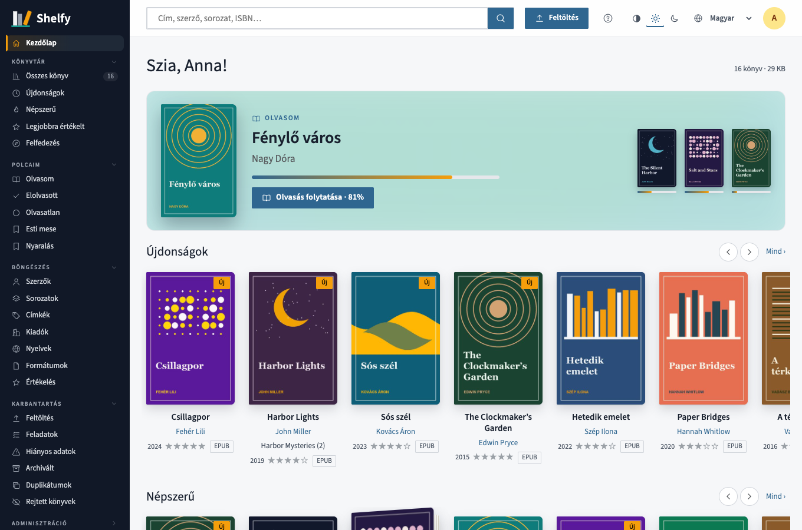

## Tartalom

- [Első lépések](#start)
- [Könyvek feltöltése](#upload)
- [Vizsgálat és átnézés](#review)
- [Böngészés a könyvtárban](#library)
- [A könyv oldala](#book)
- [Olvasás a böngészőben](#reader)
- [Kindle](#kindle)
- [Saját fiók](#account)
- [Adminisztrátoroknak](#admin)
- [Beállítások](#settings)
- [Mentés, visszaállítás, költözés](#backup)
- [Háttérfeladatok](#tasks)
- [Gyakori kérdések](#faq)

<a id="start"></a>

## Első lépések

| A bejelentkező oldal | A rövid belépő animáció bejelentkezés után | Kezdőlap: olvasás folytatása és lapozható sorok |
|---|---|---|
| 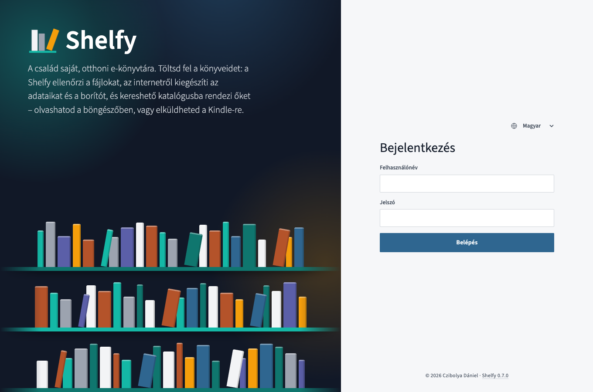 | 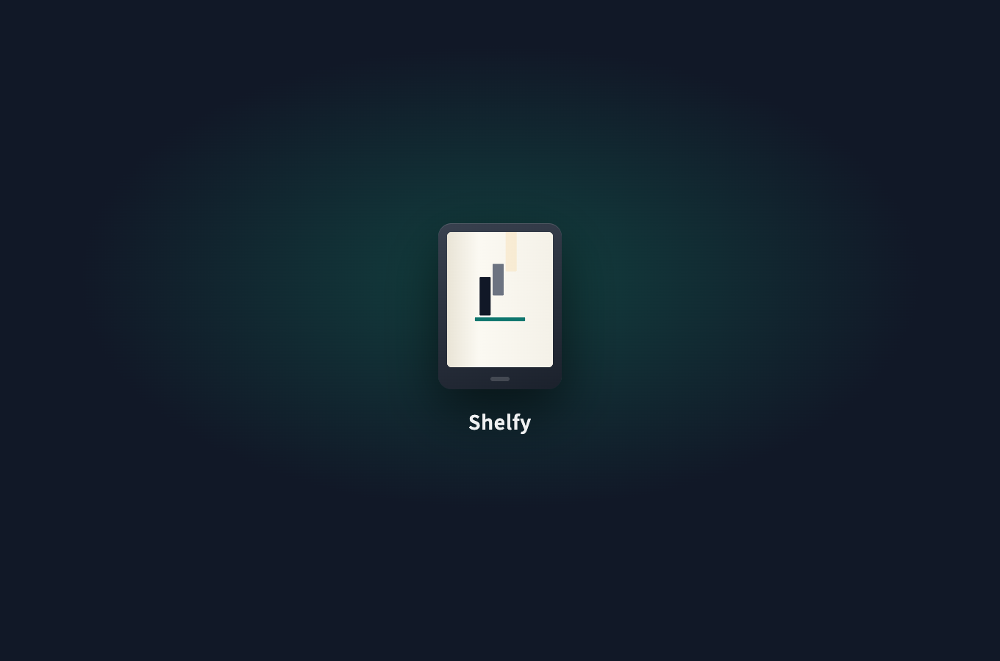 |  |

A Shelfy egy otthoni e-könyvtár: ide töltöd fel a könyveidet, a Shelfy megvizsgálja őket, online kiegészíti az adataikat, és utána bárki a családból böngészhet, letölthet vagy Kindle-re küldhet közülük.

1. **Feltöltés** – húzd be a könyveket a **Feltöltés** oldalra.
2. **Átnézés** – a vizsgálat után nézd át a javasolt adatokat, és vedd fel a könyvet a könyvtárba.
3. **Kindle** – a **Saját fiók** oldalon add meg a Kindle e-mail címedet, és a könyveket egy kattintással küldheted.

<a id="upload"></a>

## Könyvek feltöltése

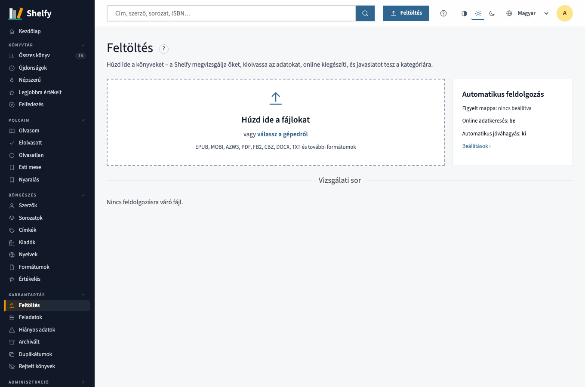

*Feltöltés*

- A **Feltöltés** oldalon húzd a fájlokat a szaggatott keretbe, vagy kattints a „válassz a gépedről” linkre. Egyszerre több fájl is mehet.
- Elfogadott formátumok: EPUB, MOBI, AZW3, AZW, PRC, PDF, FB2, CBZ, CBR, DOCX, ODT, RTF, TXT, DJVU.
- **Figyelt mappa:** ha a telepítéskor be van állítva, az oda másolt könyveket (almappákkal együtt) a Shelfy magától felveszi. Más fájlokat (képeket stb.) nem bánt, a felvett könyveket kiveszi a mappából.
- Feltöltéshez feltöltési jog kell; ezt az admin adja meg.

<a id="review"></a>

## Vizsgálat és átnézés

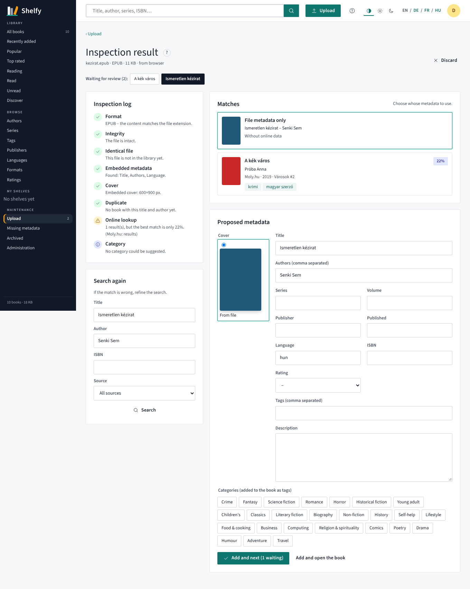

*Átnézés a vizsgálat után*

Minden feltöltött fájl automatikusan átmegy egy vizsgálaton. A *Vizsgálati jegyzőkönyv* lépésenként mutatja az eredményt:

- **Formátum, épség** – valóban az-e a fájl, aminek a kiterjesztése mondja, és nem sérült-e.
- **Azonos fájl, duplikátum** – megvan-e már ugyanez a fájl, vagy ugyanilyen című és szerzőjű könyv.
- **Adatok a fájlból, borító** – mit sikerült kiolvasni, és mekkora a beágyazott borító.
- **Online keresés** – a bekapcsolt online források találatai (lásd [Beállítások → Online források](#settings)), egyezési százalékkal.
- **Kategória** – javaslat a címkék és a leírás alapján.

Az átnézés oldalon:

- A *Találatok* közül válaszd ki a jót (vagy a „Csak a fájl adatai” lehetőséget). Ha egyik sem jó, az *Újrakeresés* mezőben pontosíthatsz címmel, szerzővel vagy ISBN-nel. ISBN helyett megadhatod az Amazon-azonosítót (ASIN, pl. B07…) vagy egy Amazon-linket is. Ha gyenge a találat, a Shelfy szabad szavasan is keres, így az egybeírt „Szerző - Cím” is megtalálható.
- A *Javasolt adatok* felvétel előtt bármikor szerkeszthetők. A borítónál választhatsz a fájlbeli és az online borító között.
- A *Kategóriák* címkeként kerülnek a könyvhöz – kattintással ki- és bekapcsolhatók.
- Ha a könyv már megvan, „Hozzáadás … formátumként” gombbal a fájl a meglévő könyvhöz kerül új formátumként.
- Ha több feltöltés vár, a lap tetején mindegyik látszik, a „Felvétel és a következő” gomb pedig rögtön a következőre lép.
- A *Mind jóváhagyása* gomb a feltöltési soron minden jó egyezésű könyvet egyszerre felvesz (a duplikátumokat kihagyja).

> Nagyobb gyűjtemény feltöltésekor érdemes bekapcsolni az *Beállítások → Biztos egyezésnél automatikus felvétel* opciót: ami legalább 85%-ban egyezik és nem duplikátum, magától bekerül.

<a id="library"></a>

## Böngészés a könyvtárban

| Rácsnézet – a borító kinyílik, ha fölé viszed az egeret | Lista nézet |
|---|---|
| 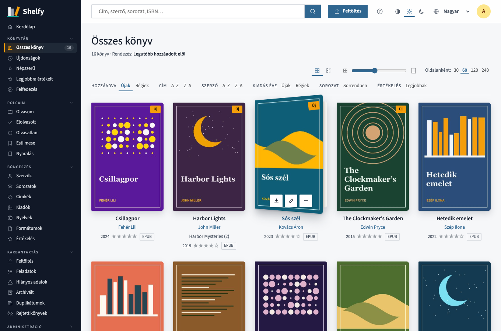 | 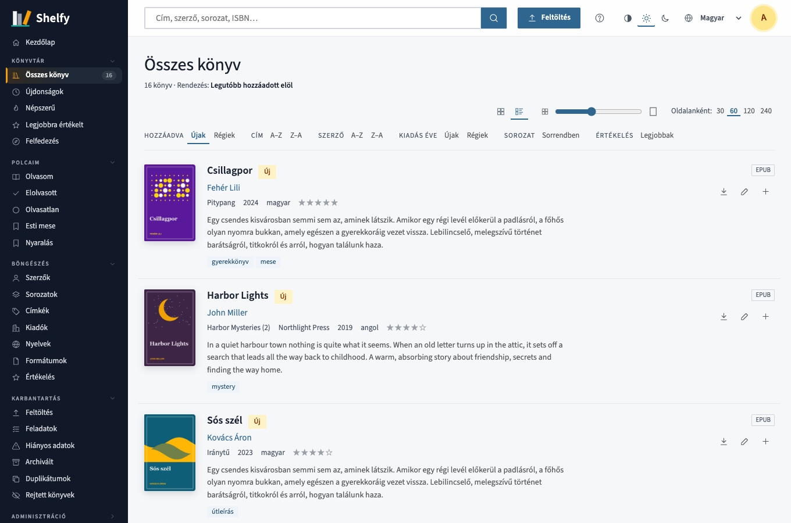 |

- **Kezdőlap** – belépés után ide érkezel: felül a félbehagyott könyved haladásjelzővel és folytatás gombbal, alatta lapozható sorokban a nemrég hozzáadott és a népszerű könyvek. A teljes lista helye a menüben: *Összes könyv*.
- **Bal menü** – a csoportok (Könyvtár, Polcaim, Böngészés, Karbantartás, Adminisztráció) a címükre kattintva összecsukhatók, a böngésző megjegyzi az állapotukat. Az olvasási állapot szerinti nézetek a *Polcaim* alatt vannak. A menü alján a neved a **Saját fiók** oldalra visz, mellette a kilépés.
- **Keresés** – a felső mezőben cím, szerző, sorozat, címke vagy ISBN alapján.
- **Nézetek** – a bal menüben: összes, újdonságok, népszerű, legjobbra értékelt, olvasási állapot szerint; a *Böngészés* alatt szerzők, sorozatok, címkék, kiadók, nyelvek, formátumok, értékelés.
- **Rendezés** – a könyvek fölötti sávban (hozzáadás, cím, szerző, kiadás éve, sorozat, értékelés). A választást megjegyzi.
- **Rács és lista** – a jobb felső ikonokkal válthatsz. Listában a borító mellett a fontosabb adatok és a leírás eleje is látszik.
- **Méret** – a csúszkával a borítók méretét (és így a soronkénti könyvek számát) állíthatod; mellette választható, hány könyv legyen egy oldalon.
- **Gyorsmenü** – rácsnézetben a borító fölé vitt egérrel letöltés, Kindle-re küldés, szerkesztés, polcra tétel.
- **Polcok** – a könyv oldalán bármelyik könyvet saját polcra teheted (pl. „Nyaralás”); a polcaid a bal menüben jelennek meg.

Telefonon és tableten a bal menü behúzható fiókká válik, amely a ☰ gombbal nyílik, és a Shelfy appként is telepíthető.

| Kezdőlap telefonon | A menü telefonon |
|---|---|
| 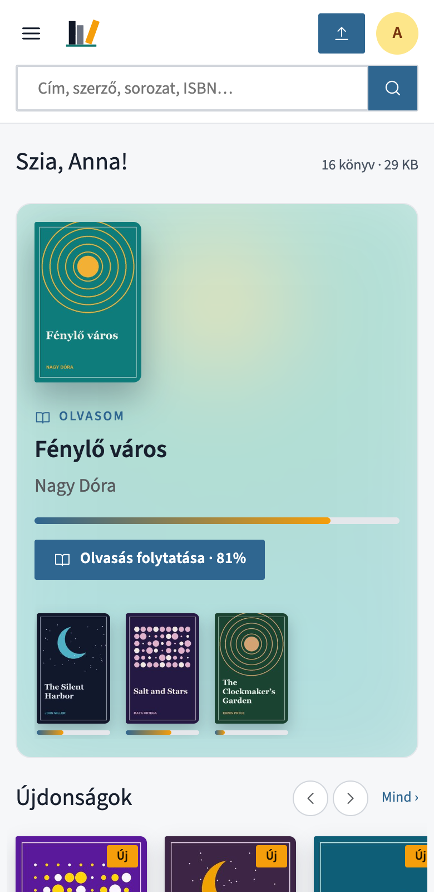 | 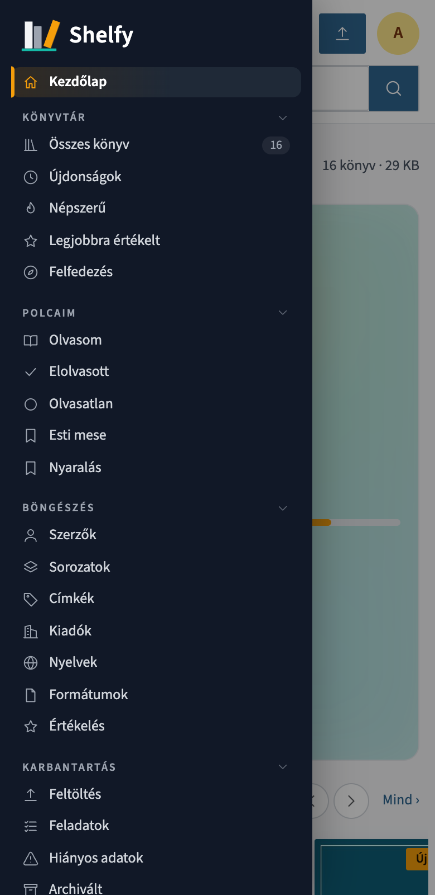 |

<a id="book"></a>

## A könyv oldala

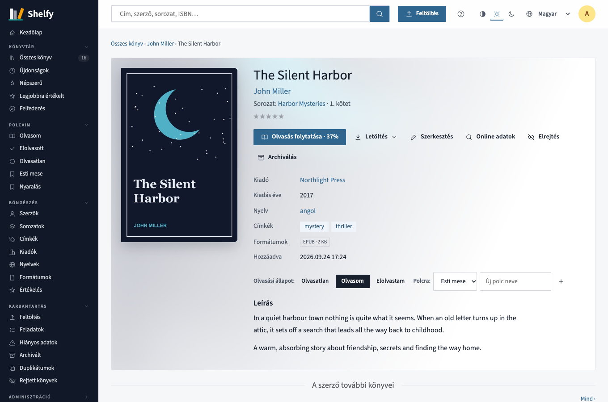

*A könyv oldala*

- **Letöltés** – bármelyik meglévő formátumban. Ha nincs meg MOBI, AZW3 vagy EPUB, letöltéskor a Shelfy elkészíti.
- **Konvertálás** – tartósan hozzáad egy új formátumot a könyvhöz (szerkesztési jog kell).
- **Szerkesztés** – minden adat, a borító is módosítható.
- **Online adatok** – friss keresés az online forrásokban; adatonként látod a jelenlegit és az online értéket, és bejelölheted, mit vegyen át.
- **Olvasási állapot** – olvasatlan, olvasom, elolvastam; mindenkinek saját.
- **Előzmények** – ki mikor töltötte le, küldte el vagy szerkesztette (szerkesztőknek látszik).

<a id="reader"></a>

## Olvasás a böngészőben

A könyv oldalán az *Olvasás* gombbal a könyv rögtön a böngészőben nyílik meg – számítógépen, tableten, telefonon. A Shelfy felhasználónként megjegyzi, hol tartasz: a gomb ilyenkor *Olvasás folytatása* a százalékkal, és másik eszközön is ott folytathatod, ahol abbahagytad.

- Az EPUB közvetlenül nyílik. A MOBI, AZW3 és más formátumokat első megnyitáskor EPUB-bá alakítja (néhány másodperc, a Feladatok között követhető). A PDF a böngésző saját PDF-nézőjében nyílik meg.
- Olvasáshoz letöltési jog kell; bejelentkezés nélkül böngésző vendégek nem olvashatnak.

### Lapozás

- **Koppints vagy kattints** a lap jobb oldalára az előrelapozáshoz, a bal harmadára a visszalapozáshoz – mint egy e-könyv-olvasón.
- A **felső sávra** koppintva előjön vagy eltűnik a felső és alsó menü, így csak a szöveg marad.
- Lapozhatsz **húzással** (balra/jobbra), billentyűzeten a nyilakkal, szóközzel és a Page Up/Down gombokkal is.
- Az alsó **csúszkával** a könyv bármely pontjára ugorhatsz; a ≡ gomb a *Tartalom*.

### Szövegbeállítások (Aa)

- **Háttér:** világos, szépia vagy sötét.
- **Betűméret**, **betűtípus** (ahogy a könyvben, Literata, Georgia, a különösen jól olvasható Atkinson Hyperlegible, vagy egyszerű talpatlan), **sorköz**, **margó**.
- **Igazítás** (sorkizárt vagy balra zárt), **elválasztás** be/ki.
- **Elrendezés:** két hasáb, ha széles a képernyő (pl. fekvő tablet), vagy mindig egy; **lapozás** vagy folyamatos **görgetés**.

A beállításokat eszközönként külön jegyzi meg, így a telefon és a tablet lehet eltérő.

### Haladás

A lap alatti sor mutatja, hol tartasz. Rákoppintva vált: százalék, a fejezetből hátralévő idő, a könyvből hátralévő idő, oldal a fejezetben. A Shelfy megtanulja az olvasási tempódat, így néhány oldal után pontos az időbecslés. A könyv végére érve a könyv elolvasottnak számít.

### Könyvjelzők, kiemelések, jegyzetek

- **Könyvjelző:** a felső sáv könyvjelző ikonja megjelöli az aktuális oldalt (újra koppintva törli).
- **Kiemelés:** jelölj ki szöveget (érintőképernyőn: nyomd hosszan, majd húzd a fogantyúkat), és válassz színt. Itt *jegyzetet* is írhatsz hozzá.
- Egy meglévő kiemelésre koppintva módosíthatod a színét, a jegyzetet, vagy törölheted.
- A ≡ panelen a *Könyvjelzők* és a *Kiemelések* külön fülön látszanak; rájuk koppintva oda ugrik.

A könyvjelzők, kiemelések és jegyzetek a szerveren, a fiókodhoz mentődnek, így minden eszközön megvannak.

> Tableten és telefonon érdemes a Shelfyt a kezdőképernyőre tenni (lásd [Kindle → Telefonon](#kindle)): így az olvasó teljes képernyőn, a böngésző sávjai nélkül nyílik meg – mint egy e-könyv-olvasó app. Olvasáshoz kapcsolat kell a Shelfyhez.

<a id="kindle"></a>

## Kindle

| Kindle-nézet – lista | Kindle-nézet – könyv |
|---|---|
| 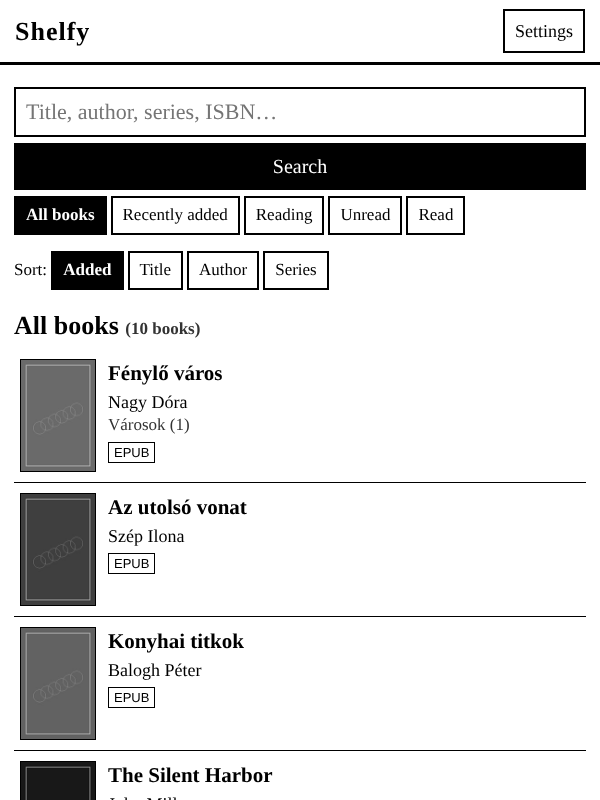 | 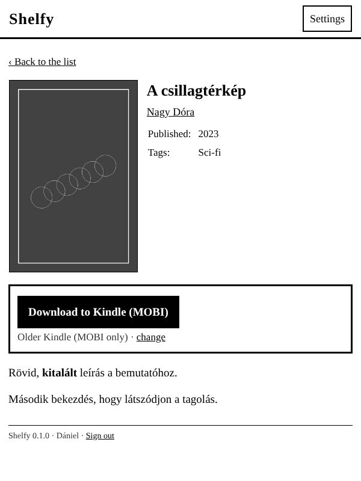 |

### Küldés e-mailben

1. A **Saját fiók** oldalon add meg a Kindle e-mail címedet (…@kindle.com).
2. Az Amazon-fiókodban vedd fel a küldő címet a jóváhagyott feladók közé (*Manage Your Content and Devices → Preferences → Personal Document Settings*).
3. A könyv oldalán vagy a gyorsmenüben: *Küldés Kindle-re*.

A küldő fiókot az admin állítja be közösen, de mindenki megadhat sajátot is a Saját fiók oldalon (a Gmail-beállításhoz súgó is van ott). Ha egy könyv csak MOBI-ban vagy AZW3-ban van meg, a Shelfy előbb EPUB-ot készít belőle, mert az Amazon már csak azt fogadja. A legnagyobb küldhető méret 50 MB.

### Letöltés a Kindle böngészőjéből

Kindle-ről megnyitva a Shelfy magától az egyszerű, e-ink-barát Kindle-nézetet mutatja. A *Beállítások* alatt válaszd ki, újabb (AZW3) vagy régebbi Kindle-t (csak MOBI) használsz. Régi Kindle-lel a helyi hálózati címet használd (http://…), mert a régi böngésző sok HTTPS-oldalt nem tud megnyitni.

### Telefonon

Telefonon és tableten a bal oldali menü elrejtőzik: bal felül a ☰ gombbal nyílik (benne a téma, a nyelv és a súgó is). A böngésző menüjében a „Hozzáadás a kezdőképernyőhöz” után a Shelfy saját ikonnal, külön appként nyílik meg – iPhone-on és iPaden Safariban: Megosztás → Főképernyőhöz adás. Telefonon és tableten a Shelfy ezt egy kis ablakban magától is felajánlja; később a ☰ menüben a „Telepítés appként” pontnál találod.

<a id="account"></a>

## Saját fiók

| Saját fiók | Sötét téma |
|---|---|
| 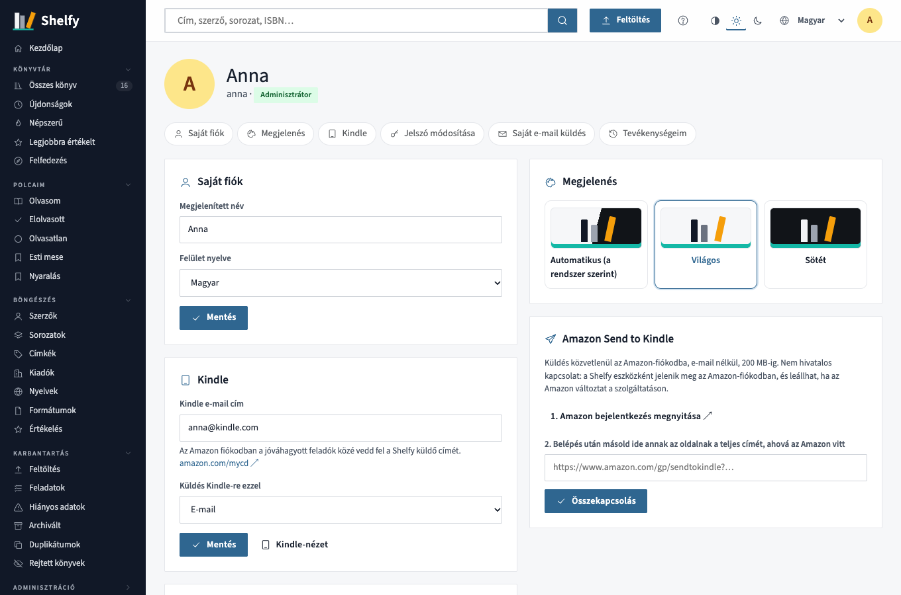 | 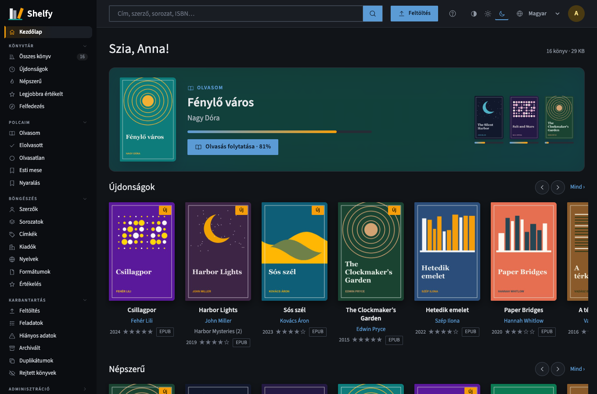 |

- Az oldal tetején lévő gombok a szakaszokhoz ugranak. A *Megjelenés* kártyán választhatsz automatikus, világos és sötét téma között.
- Megjelenített név, felület nyelve, Kindle e-mail cím, jelszócsere.
- Saját e-mail küldés (SMTP) – ha üresen hagyod, a közös fiók megy.
- Tevékenységeim – a saját letöltéseid, küldéseid és feltöltéseid listája.
- A felső sávban a nyelv és a megjelenés (automatikus / világos / sötét) is állítható – telefonon és tableten a ☰ menüben.

<a id="admin"></a>

## Adminisztrátoroknak

| Felhasználók | Napló |
|---|---|
| 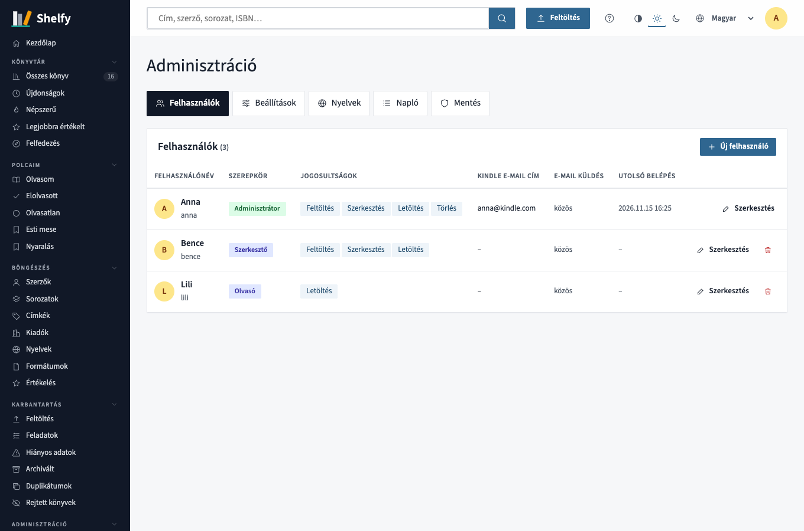 | 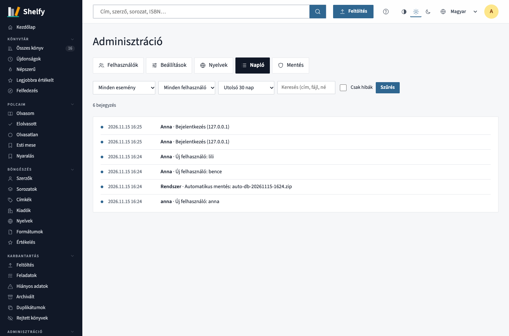 |

- **Felhasználók** – szerepkörök: adminisztrátor (mindenhez hozzáfér), szerkesztő, olvasó; a jogok (feltöltés, szerkesztés, letöltés, törlés) egyenként is állíthatók. Itt adhatsz meg valakinek saját e-mail beállítást is.
- **Beállítások** – külön menüpont a bal oldalon; részletesen a [Beállítások](#settings) résznél.
- **Nyelvek** – minden felirat fordítható; itt látszik, mennyire teljes egy nyelv, és új nyelv is felvehető. A felületen szerkesztett fordítások a frissítéskor sem vesznek el.
- **Napló** – minden fontos esemény időbélyeggel: feltöltés, felvétel, küldés (hibával együtt), letöltés, belépés, beállításváltozás. Szűrhető típusra, felhasználóra, időszakra, és csak a hibák is megjeleníthetők.
- **Könyvek elrejtése** – a könyv oldalán az *Elrejtés* gombbal a könyvet csak az adminisztrátorok látják: a többi felhasználó és a vendégek sehol nem találkoznak vele (listák, keresés, böngészés, Kindle-nézet), az oldala és a fájljai sem nyithatók meg. Adminként a rejtett könyvek jelölve látszanak, és a bal menü *Rejtett könyvek* pontjában is megtalálod őket; a *Láthatóvá tétel* gombbal visszaállíthatók.
- **Archiválás** – a könyv oldalán az *Archiválás* gombbal a könyv kikerül a könyvtár listáiból, a böngészésből és a darabszámokból, de a bal menü *Archivált* pontjában mindenki számára elérhető marad (pl. régi, de megtartandó könyvek). A *Visszaállítás az archívumból* visszateszi. Az elrejtéssel szemben az archivált könyvet továbbra is bárki megnyithatja.
- **Duplikátumok** – a bal menü **Duplikátumok** pontjában (vagy a Feladatok oldalon a *Duplikátumok keresése* gombbal) bármikor indíthatsz keresést: azonos fájlú, azonos ISBN-ű, vagy azonos című és közös szerzőjű könyveket keres (a nevek szórendje nem számít). Egy könyv több formátuma – pl. MOBI és AZW3 ugyanannál a könyvnél – *nem* duplikátum. Csoportonként válaszd ki, melyik könyv maradjon, és nyomd meg az *Egyesítés* gombot: a hiányzó formátumok, a borító és az üres adatok átkerülnek, a címkék összeadódnak, az olvasási állapot, könyvjelzők, kiemelések és polcok is átkerülnek, a többi példány pedig törlődik. A *Mind egyesítése* ezt minden csoportra elvégzi a javasolt könyvvel (a legtöbb formátum és legteljesebb adatok); a *Nem duplikátum* végleg elrejti a csoportot.

### Elfelejtett jelszó

Egy felhasználó jelszavát az admin a Felhasználók oldalon állíthatja vissza. Ha az admin a sajátját felejtette el, a szerveren:

```sh
docker exec -it shelfy python -m app.reset_password <felhasználónév>
```

<a id="settings"></a>

## Beállítások

Adminisztrátoroknak: a bal menü **Beállítások** pontja. A változások azonnal érvényesek, nem kell újraindítani.

### Általános

- **Alapnyelv** – a felület nyelve a látogatóknak és az új felhasználóknak; ezen a nyelven kerülnek a kategória-címkék a könyvekhez. Mindenki választhat saját nyelvet.
- **Online adatkeresés** – keressen-e online forrásokban feltöltéskor és a könyv oldalán.
- **Figyelt mappa figyelése** – kikapcsolva szünetel, például amíg rendezed a mappát. (Magát a mappát telepítéskor kell megadni.)
- **Biztos egyezésnél automatikus felvétel** – ami legalább 85%-ban egyezik és nem duplikátum, átnézés nélkül bekerül.

### Hozzáférés

**Böngészés bejelentkezés nélkül** – fiók nélkül is végig lehet nézni a könyvtárat, keresni és megnyitni a könyvek oldalát. Letöltéshez, olvasáshoz, Kindle-re küldéshez, polcokhoz és minden módosításhoz továbbra is be kell jelentkezni.

### Online források

Melyik adatbázisokban keresse a könyveket, és milyen fontossági sorrendben:

- **Moly.hu** – magyar könyves adatbázis leírással, sorozattal, címkékkel; magyar könyvekhez a legjobb forrás.
- **Google Books** – világszerte, sok nyelven; leírás és borító.
- **Open Library** – ingyenes, világméretű katalógus; régebbi és angol nyelvű könyvekhez jó.
- **DNB** (német), **BnF** (francia), **Biblioteka Narodowa** (lengyel), **NDL** (japán) – nemzeti könyvtárak, az adott országban kiadott könyvekhez.

Pipáld be a használni kívánt forrásokat, és a nyilakkal állítsd sorba őket. A Shelfy egyszerre mindegyikben keres, és a találatokat az egyezés szerint rangsorolja; ha két találat nagyjából egyformán jó, a listában feljebb álló forrás nyer. A *Javasolt beállítás* gomb az alapnyelvhez illő listát állít be – magyar könyvekhez általában a Moly.hu egyedül is elég.

> Saját kulcs nélkül a Google Books egy kicsi, közös kvótát ad, ami gyakran elfogy (a vizsgálati jegyzőkönyvben „HTTP 429” hiba). Ezt egy ingyenes, a Google Cloud konzolban kérhető *Google Books API-kulcs* megoldja; titkosítva tárolódik.

### E-mail

A közös e-mail fiók (SMTP) a Kindle-re küldéshez, próba e-mail gombbal.

<a id="backup"></a>

## Mentés, visszaállítás, költözés

A Shelfy két részből áll:

- **adatbázis** (`shelfy.db` az adatmappában): könyvadatok, felhasználók, polcok, olvasási állapot, napló, beállítások – kicsi, néhány MB;
- **könyvtár mappa**: a könyvfájlok és borítók `Szerző/Cím (azonosító)/` szerkezetben – ez a nagy rész. Az adatbázis ezekre a fájlokra hivatkozik.

A kettő együtt adja a teljes könyvtárat. Az *Adminisztráció → Mentés* oldalon:

- **Csak az adatbázis** – kis ZIP. Akkor elég, ha a könyvtár mappa a NAS-on van, és azt a NAS saját mentése (pl. másik kötetre vagy felhőbe) menti.
- **Teljes mentés** – adatbázis + minden könyvfájl és borító egy ZIP-ben (100 könyv kb. 100 MB). Ezzel egyben költöztethető az egész Shelfy.
- **Automatikus mentés** – naponta adatbázis-mentés az adatmappa `backups` mappájába; beállítható, hány napot tartson meg.

### Költözés másik gépre

1. A régi Shelfyben töltsd le a **teljes mentést**.
2. Az új helyen indítsd el a Shelfyt, hozz létre egy ideiglenes admin fiókot.
3. *Adminisztráció → Mentés → Visszaállítás*: töltsd fel a ZIP-et. Az adatbázis és a könyvfájlok a helyükre kerülnek, a régi felhasználókkal és jelszavakkal be lehet lépni.

Másik út: a könyvtár mappát a NAS-on egyszerűen átmásolod az új helyre, és csak az adatbázis-mentést állítod vissza. Utána a *Könyvtár ellenőrzése* megmutatja, ha valamelyik fájl hiányzik.

### Nagy könyvtárnál parancssorból

```sh
docker exec shelfy python -m app.backup create --full      # teljes mentés a backups mappába
docker exec shelfy python -m app.backup check              # hiányzó fájlok keresése
docker compose stop shelfy
docker compose run --rm shelfy python -m app.backup restore /data/backups/<fájl>.zip
docker compose start shelfy
```

> A mentés a jelszavak kivonatát és a titkosítás kulcsát is tartalmazza – biztonságos helyen tárold. Visszaállítás előtt a Shelfy mindig ment egyet a mostani állapotról (`before-restore-…zip`).

<a id="tasks"></a>

## Háttérfeladatok

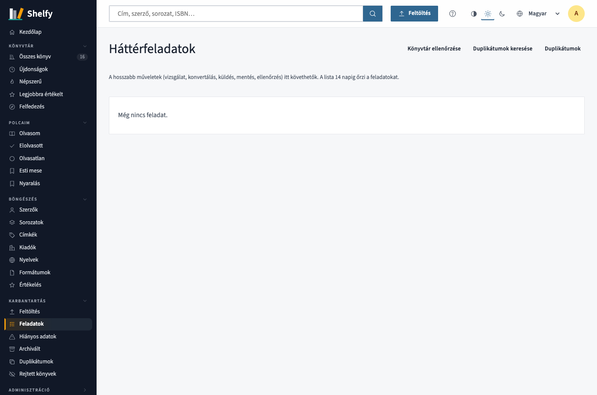

*Háttérfeladatok*

A hosszabb műveletek – feltöltések vizsgálata, konvertálás, Kindle-re küldés, mentés, visszaállítás – a **Feladatok** oldalon követhetők: ki indította, mi az állapota, mennyi ideig futott és mi lett az eredménye. Az oldalsávon a futó feladatok száma is látszik. Az adminisztrátor innen indíthatja a könyvtár ellenőrzését (hiányzó fájlok) és a duplikátumok keresését. A feladatok 14 napig maradnak a listában.

<a id="faq"></a>

## Gyakori kérdések

**Nem jön meg a könyv a Kindle-re.**  
Nézd meg a *Napló*t (adminként) vagy a *Tevékenységeim* listát: ha a küldés sikertelen, ott az oka. Ha sikeres volt, a feladó cím valószínűleg nincs jóváhagyva az Amazonnál.

**Rossz adatokat vett át a feltöltéskor.**  
A könyv oldalán az *Online adatok* gombbal újra kereshetsz, vagy a *Szerkesztés*sel kézzel javíthatsz.

**Hiányzik a borító.**  
A *Hiányos adatok* nézet listázza a borító vagy leírás nélküli könyveket; az Online adatok vagy a Szerkesztés (borító feltöltése) segít.

**Nem nyílik meg a könyv az olvasóban.**  
Az EPUB-on és PDF-en kívüli formátumokat előbb át kell alakítani – ha ez nem sikerül, az olvasó jelzi, de letölteni ettől még le tudod. Az okát a Feladatok oldal mutatja.

**Tableten a lapra koppintva nem lapoz.**  
Görgetés módban a koppintás csak a sávokat rejti el/hozza elő – az Aa alatt válts *Lapozás*ra. Linkre koppintva vagy kijelölt szövegnél sem lapoz.
