# Shelfy user manual

*English · [Magyar](MANUAL.hu.md)*

Shelfy is your family’s own ebook library at home. You upload your books, Shelfy checks the files, fills in the details and the cover from the internet, and puts everything in a searchable catalogue – to read in the browser or send to a Kindle.

This manual follows the built-in help (the **?** icon in the top bar, or the *Help* item in the menu), which is available in all 14 interface languages. For installation, updating and the environment variables see the [README](README.md).

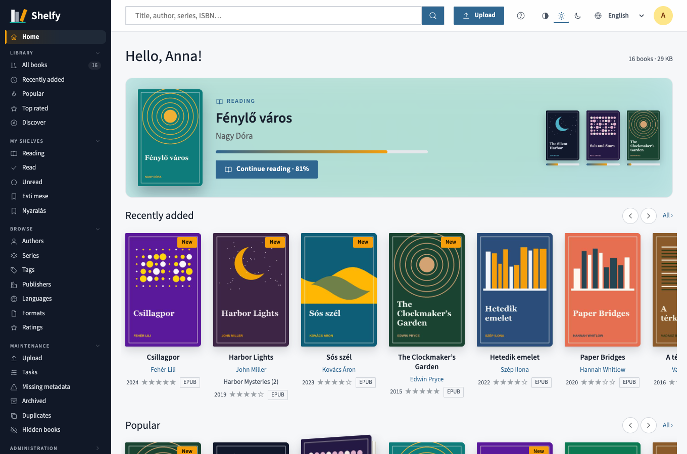

## Contents

- [Getting started](#start)
- [Uploading books](#upload)
- [Inspection and review](#review)
- [Browsing the library](#library)
- [The book page](#book)
- [Reading in the browser](#reader)
- [Kindle](#kindle)
- [My account](#account)
- [For administrators](#admin)
- [Settings](#settings)
- [Backup, restore, moving](#backup)
- [Background tasks](#tasks)
- [Frequently asked questions](#faq)

<a id="start"></a>

## Getting started

| The sign-in page | The short intro animation after signing in | Home page: continue reading and scrollable rows |
|---|---|---|
| 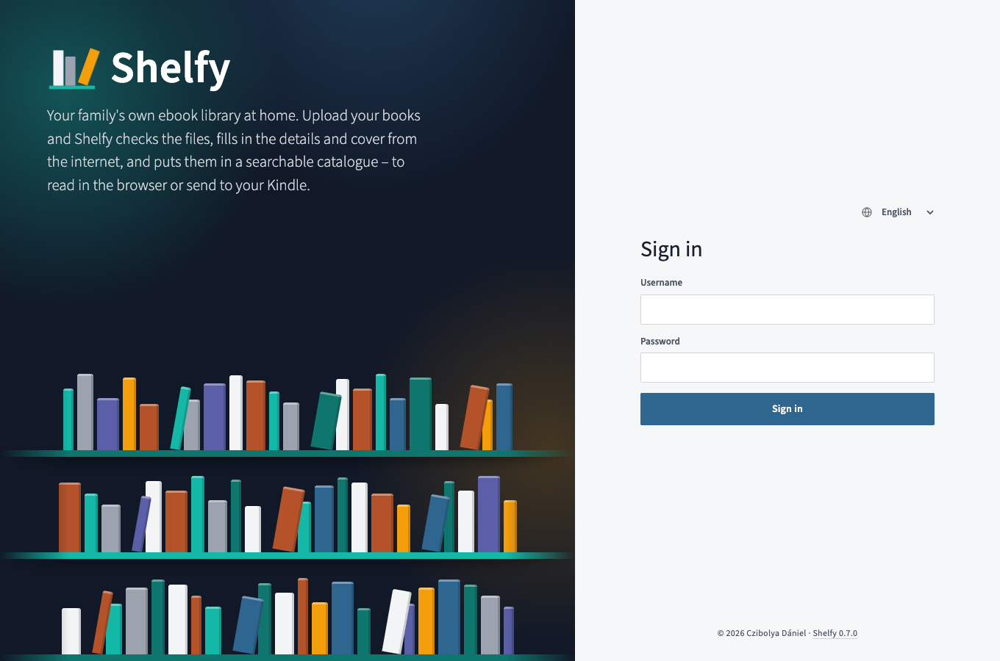 | 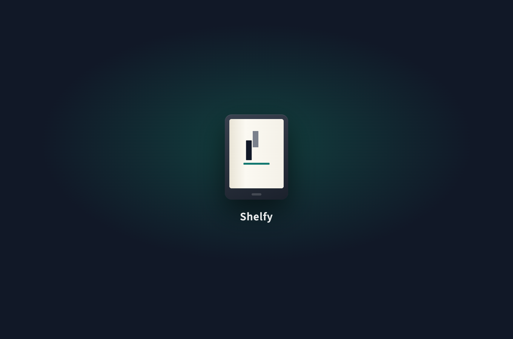 |  |

Shelfy is a home ebook library: you upload your books, Shelfy inspects them and completes their metadata online, and then anyone in the family can browse, download or send them to a Kindle.

1. **Upload** – drag your books onto the **Upload** page.
2. **Review** – after the inspection, check the proposed metadata and add the book to the library.
3. **Kindle** – enter your Kindle e-mail address on the **My account** page, and send books with one click.

<a id="upload"></a>

## Uploading books

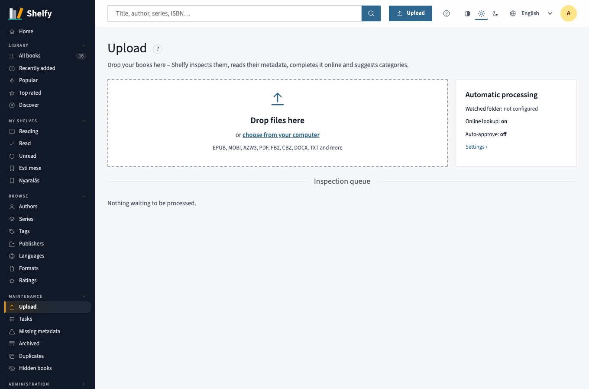

*Upload*

- On the **Upload** page, drop files into the dashed box or click “choose from your computer”. You can upload several files at once.
- Supported formats: EPUB, MOBI, AZW3, AZW, PRC, PDF, FB2, CBZ, CBR, DOCX, ODT, RTF, TXT, DJVU.
- **Watched folder:** if configured at installation, ebooks copied there (including subfolders) are picked up automatically. Other files (images etc.) are left alone; imported books are moved out of the folder.
- Uploading requires the upload permission, granted by an administrator.

<a id="review"></a>

## Inspection and review

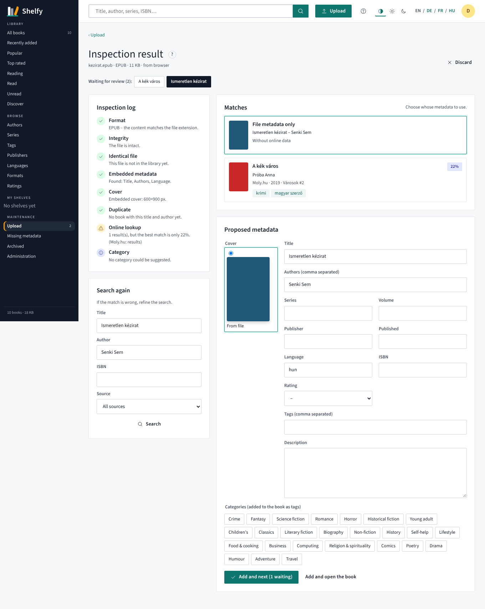

*Review after inspection*

Every uploaded file is inspected automatically. The *Inspection log* shows the result step by step:

- **Format, integrity** – is the file what its extension says, and is it intact?
- **Identical file, duplicate** – is this exact file, or a book with the same title and author, already in the library?
- **Embedded metadata, cover** – what could be read from the file, and how large the embedded cover is.
- **Online lookup** – matches from the enabled online sources (see [Settings → Online sources](#settings)), with a match percentage.
- **Category** – a suggestion based on tags and description.

On the review page:

- Pick the right one from the *Matches* (or “File metadata only”). If none fits, refine the search with title, author or ISBN under *Search again*. Instead of the ISBN you can also enter an Amazon ID (ASIN, e.g. B07…) or an Amazon link. When the match is weak, Shelfy also runs a free-text search, so a combined “Author - Title” is found too.
- The *Proposed metadata* can be edited before adding. For the cover, choose between the embedded and the online one.
- *Categories* are added to the book as tags – click to toggle them.
- If you already have the book, “Add as … format” attaches the file to the existing book as a new format.
- If several uploads are waiting, they are all listed at the top, and “Add and next” moves straight on to the next one.
- *Approve all* in the upload queue adds every book with a good match at once (duplicates are skipped).

> When importing a larger collection, turn on *Settings → Add automatically on a confident match*: anything with at least an 85% match that is not a duplicate is added on its own.

<a id="library"></a>

## Browsing the library

| Grid view – the cover opens when you point at it | List view |
|---|---|
| 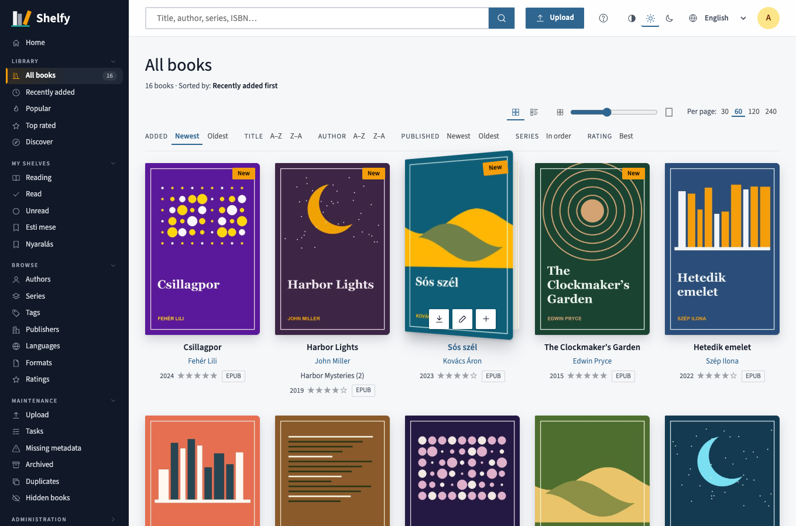 | 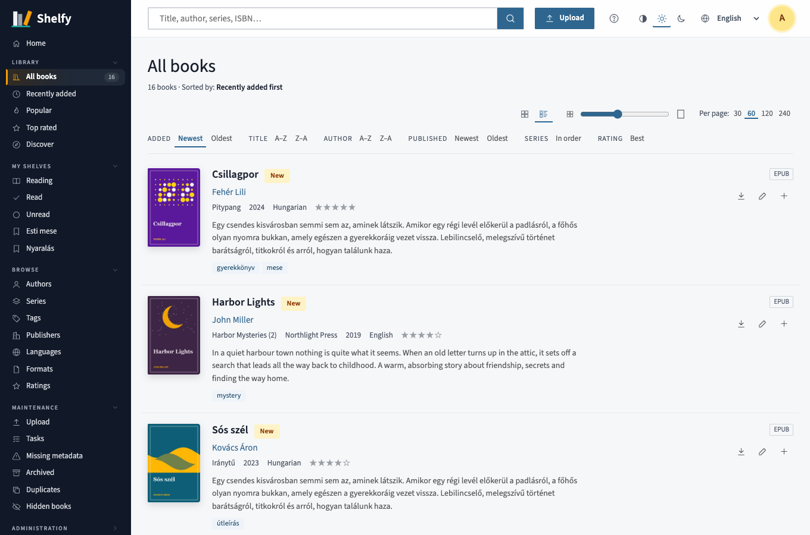 |

- **Home** – where you land after signing in: the book you are in the middle of, with its progress and a continue button, then scrollable rows of recently added and popular books. The full list is under *All books*.
- **Left menu** – the groups (Library, My shelves, Browse, Maintenance, Administration) collapse when you click their title, and the browser remembers their state. The views by reading status are under *My shelves*. At the bottom, your name opens **My account**, with sign-out next to it.
- **Search** – the top field searches title, author, series, tag and ISBN.
- **Views** – in the left menu: all, recently added, popular, top rated, by reading status; under *Browse*: authors, series, tags, publishers, languages, formats, ratings.
- **Sorting** – in the bar above the books (added, title, author, published, series, rating). Your choice is remembered.
- **Grid and list** – switch with the icons at the top right. The list shows the main details and the start of the description next to the cover.
- **Size** – the slider sets the cover size (and so how many books fit in a row); next to it you choose how many books appear per page.
- **Quick menu** – in grid view, hover over a cover to download, send to Kindle, edit or add to a shelf.
- **Shelves** – put any book on a personal shelf from its page (e.g. “Holiday”); your shelves appear in the left menu.

On a phone or tablet the left menu becomes a drawer that opens with the ☰ button, and Shelfy can be installed as an app.

| Home page on a phone | The menu on a phone |
|---|---|
| 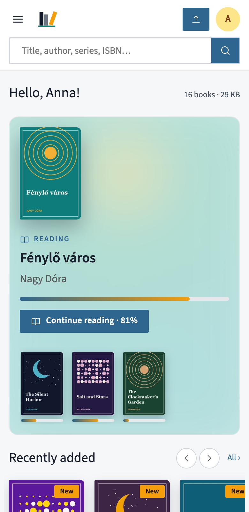 | 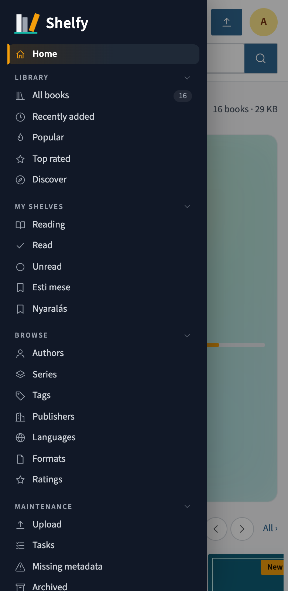 |

<a id="book"></a>

## The book page

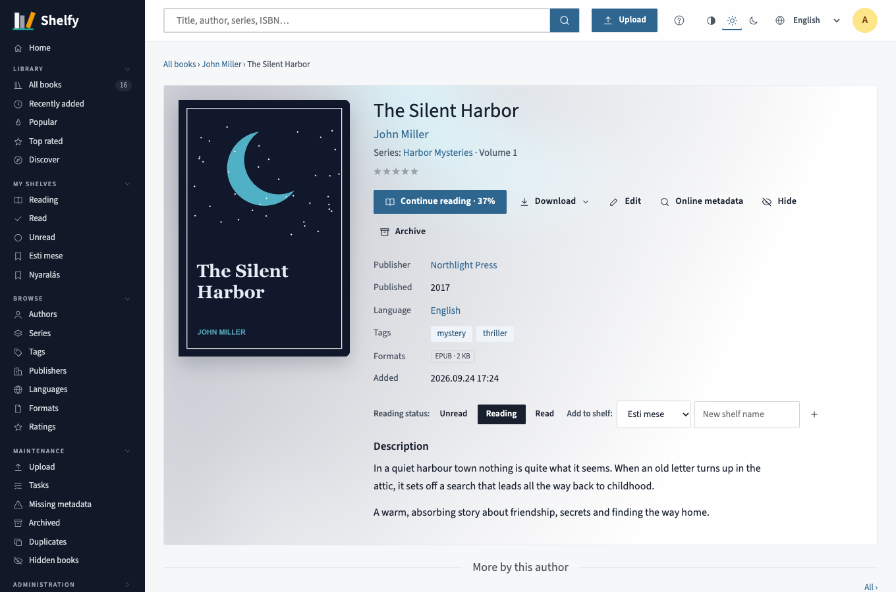

*Book page*

- **Download** – in any existing format. If MOBI, AZW3 or EPUB is missing, Shelfy creates it when you download.
- **Convert** – permanently adds a new format to the book (requires the edit permission).
- **Edit** – every field, including the cover.
- **Online metadata** – a fresh search in the online sources; you see the current and the online value side by side and tick what to take over.
- **Reading status** – unread, reading, read; separate for every user.
- **History** – who downloaded, sent or edited the book and when (visible to editors).

<a id="reader"></a>

## Reading in the browser

Press *Read* on a book’s page and the book opens right in the browser – on a computer, a tablet or a phone. Shelfy remembers where you stopped, per user: the button then says *Continue reading* with your percentage, and you can carry on from another device where you left off.

- EPUB opens directly. MOBI, AZW3 and other formats are converted to EPUB the first time (this takes a few seconds; you can follow it under Tasks). PDF opens in the browser’s own PDF viewer.
- Reading needs download permission; guests browsing without signing in cannot read.

### Turning pages

- **Tap or click** the right side of the page to go forward and the left third to go back – just like on an e-reader.
- A tap on the **top strip** shows or hides the top and bottom bars, so only the text remains.
- You can also **swipe** left or right, or use the arrow keys, Space and Page Up/Down on a keyboard.
- The **slider** at the bottom jumps anywhere in the book; the ≡ button opens the *Contents*.

### Text settings (Aa)

- **Background:** light, sepia or dark.
- **Text size**, **typeface** (as in the book, Literata, Georgia, Atkinson Hyperlegible – especially easy to read – or a plain sans-serif), **line spacing**, **margins**.
- **Alignment** (justified or left), **hyphenation** on/off.
- **Layout:** two columns when the screen is wide (e.g. a tablet held sideways) or always one; **pages** or continuous **scrolling**.

The settings are remembered on each device separately, so the phone and the tablet can look different.

### Progress

The line under the page shows where you are. Tap it to switch between: percentage, time left in the chapter, time left in the book, and page within the chapter. Shelfy learns your reading pace, so the time estimates become accurate after a few pages. When you reach the end, the book is marked as read.

### Bookmarks, highlights, notes

- **Bookmark:** the bookmark icon at the top marks the current page (tap again to remove it).
- **Highlight:** select some text (on a touch screen: press and hold, then drag the handles) and choose a colour. Here you can also add a *note* to it.
- Tap an existing highlight to change its colour, edit the note or delete it.
- The ≡ panel lists the *Bookmarks* and *Highlights* on separate tabs; tap one to jump there.

Bookmarks, highlights and notes are saved on the server under your account, so they are there on every device.

> On a tablet or phone it is worth adding Shelfy to the home screen (see [Kindle → On a phone](#kindle)): then the reader opens full screen, without the browser’s bars – like an e-reader app. Reading needs a connection to Shelfy.

<a id="kindle"></a>

## Kindle

| Kindle view – list | Kindle view – book |
|---|---|
| 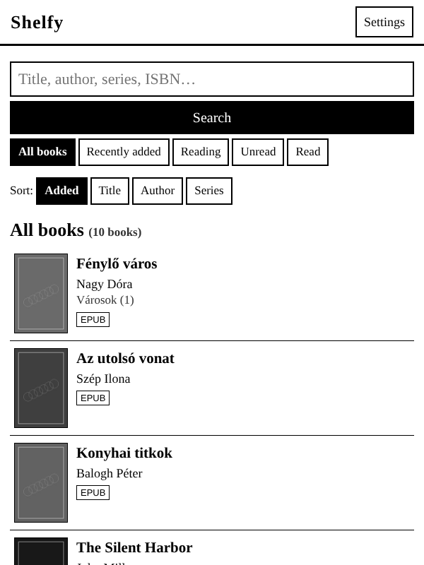 | 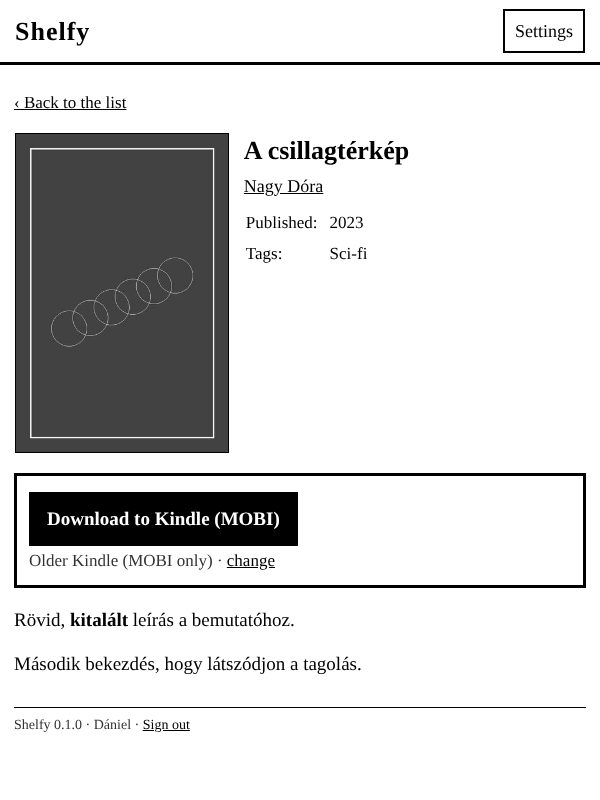 |

### Sending by e-mail

1. On **My account**, enter your Kindle e-mail address (…@kindle.com).
2. In your Amazon account, add the sender address to the approved senders (*Manage Your Content and Devices → Preferences → Personal Document Settings*).
3. On the book page or in the quick menu: *Send to Kindle*.

The administrator sets up a shared sending account, but everyone can add their own on My account (there is a Gmail help there). If a book only exists as MOBI or AZW3, Shelfy first creates an EPUB, because Amazon only accepts EPUB now. The maximum size is 50 MB.

### Downloading from the Kindle browser

Opened on a Kindle, Shelfy automatically shows the simple, e-ink friendly Kindle view. Under *Settings*, choose a newer (AZW3) or older Kindle (MOBI only). With an older Kindle, use the local network address (http://…), because the old browser cannot open many HTTPS sites.

### On a phone

On a phone or tablet the left menu folds away: open it with the ☰ button at the top left (theme, language and help are in there too). In the browser menu, “Add to Home Screen” makes Shelfy open with its own icon as a separate app – on iPhone and iPad in Safari: Share → Add to Home Screen. Shelfy also offers this itself in a small window on phones and tablets; later you find it as “Install as an app” in the ☰ menu.

<a id="account"></a>

## My account

| My account | Dark theme |
|---|---|
| 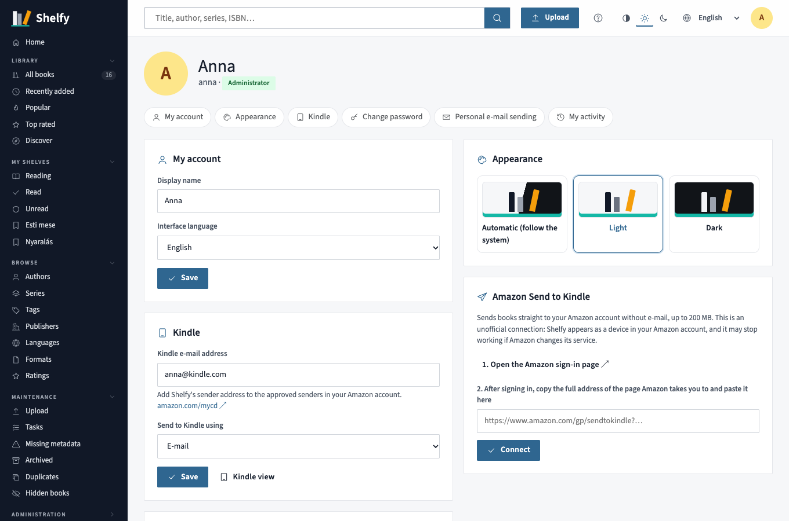 | 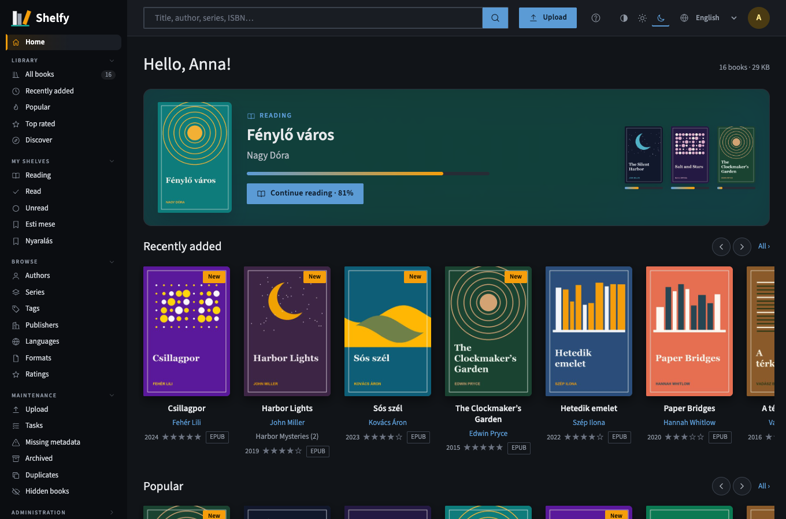 |

- The buttons at the top of the page jump to each section. On the *Appearance* card you choose between the automatic, light and dark theme.
- Display name, interface language, Kindle e-mail address, password change.
- Personal e-mail sending (SMTP) – if left empty, the shared account is used.
- My activity – your own downloads, sends and uploads.
- The language and the appearance (automatic / light / dark) can be set in the top bar – on a phone or tablet, in the ☰ menu.

<a id="admin"></a>

## For administrators

| Users | Activity log |
|---|---|
| 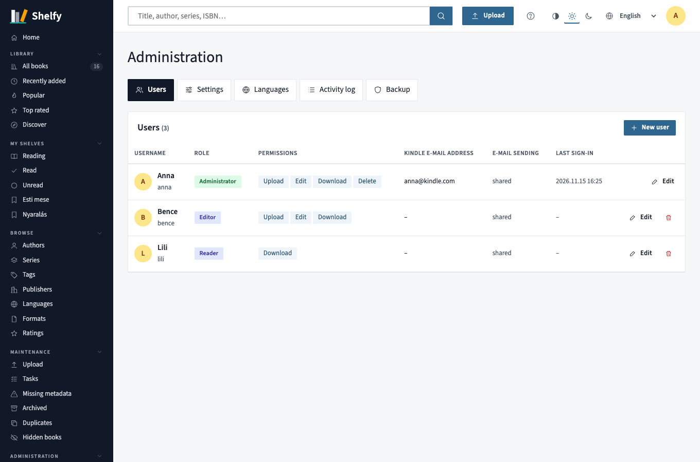 | 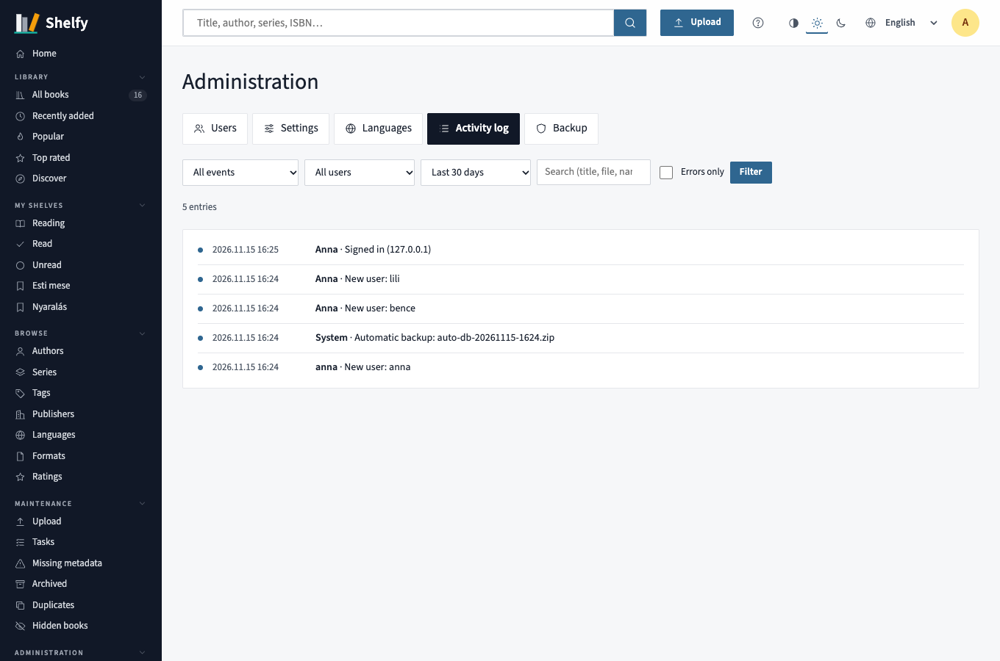 |

- **Users** – roles: administrator (full access), editor, reader; the permissions (upload, edit, download, delete) can also be set one by one. You can also give someone personal e-mail settings here.
- **Settings** – its own item in the left menu; described in detail under [Settings](#settings).
- **Languages** – every label is translatable; see how complete each language is and add new ones. Translations edited in the interface survive updates.
- **Activity log** – every important event with a timestamp: uploads, additions, sends (including failures), downloads, sign-ins, settings changes. Filter by type, user and period, or show errors only.
- **Hiding books** – the *Hide* button on a book’s page makes it visible to administrators only: other users and guests do not see it anywhere (lists, search, browsing, Kindle view), and its page and files cannot be opened. Hidden books are marked for administrators and listed under *Hidden books* in the left menu; *Make visible* brings them back.
- **Archiving** – *Archive* on a book’s page takes it out of the library lists, browsing and counts, but it stays available to everyone under *Archived* in the left menu (e.g. books you have finished with but want to keep). *Restore from archive* puts it back. Unlike hiding, archived books can still be opened by everyone.
- **Duplicates** – **Duplicates** in the left menu (or *Find duplicates* on the Tasks page) runs a search whenever you like: books with the same file, the same ISBN, or the same title and a common author (word order of names does not matter). Different formats of one book – e.g. MOBI and AZW3 on the same book – are *not* duplicates. For each group choose which book to keep and press *Merge*: missing formats, the cover and empty details are taken over, tags combined, reading progress, bookmarks, highlights and shelves moved, and the other copies deleted. *Merge all* does this for every group with the suggested book (most formats and most complete details); *Not duplicates* hides a group for good.

### Forgotten password

An administrator can reset a user's password on the Users page. If the administrator has forgotten their own, run this on the server:

```sh
docker exec -it shelfy python -m app.reset_password <username>
```

<a id="settings"></a>

## Settings

For administrators: the **Settings** item in the left menu. Changes take effect immediately, no restart needed.

### General

- **Default language** – the interface language for visitors and new users; category tags are added to books in this language. Everyone can still choose their own language.
- **Online metadata lookup** – whether to search online sources on upload and on the book page.
- **Watch the import folder** – switch it off to pause, e.g. while you tidy the folder. (The folder itself is set at installation.)
- **Add automatically on a confident match** – a book matching at least 85% that is not a duplicate goes into the library without review.

### Access

**Allow browsing without signing in** – visitors without an account can browse the library, search and open book pages. Downloading, reading, sending to Kindle, shelves and any change still require signing in.

### Online sources

Which databases Shelfy looks books up in, and in what order of importance:

- **Moly.hu** – Hungarian book database with description, series and tags; the best source for Hungarian books.
- **Google Books** – worldwide, many languages; description and cover.
- **Open Library** – free worldwide catalogue; good for older and English-language books.
- **DNB** (German), **BnF** (French), **Biblioteka Narodowa** (Polish), **NDL** (Japanese) – national libraries, for books published in that country.

Tick the sources to use and order them with the arrows. Shelfy searches all of them at once and ranks the matches by how well they fit; when two matches are about equally good, the source higher in the list wins. The *Suggested* button sets a sensible list for the default language – for Hungarian books, Moly.hu alone is usually enough.

> Without its own key, Google Books shares a small common quota that often runs out (shown in the inspection report as “HTTP 429”). A free *Google Books API key* from the Google Cloud console solves this; it is stored encrypted.

### E-mail

The shared e-mail account (SMTP) for sending to Kindle, with a test e-mail button.

<a id="backup"></a>

## Backup, restore, moving

Shelfy has two parts:

- the **database** (`shelfy.db` in the data folder): book metadata, users, shelves, reading status, activity log, settings – small, a few MB;
- the **library folder**: book files and covers in `Author/Title (id)/` folders – the big part. The database points to these files.

Together they make up the whole library. On *Administration → Backup*:

- **Database only** – a small ZIP. Enough if the library folder lives on the NAS and the NAS's own backup (e.g. to another volume or the cloud) covers it.
- **Full backup** – database + all book files and covers in one ZIP (100 books are roughly 100 MB). Moves the whole of Shelfy in one go.
- **Automatic backup** – a daily database backup into the `backups` folder of the data folder; choose how many days to keep.

### Moving to another machine

1. In the old Shelfy, download a **full backup**.
2. Start Shelfy in the new place and create a temporary admin account.
3. *Administration → Backup → Restore*: upload the ZIP. The database and the book files are put in place, and the old users can sign in with their passwords.

Alternatively, copy the library folder to the new place on the NAS and restore only the database backup. *Check the library* then shows any missing files.

### From the command line for large libraries

```sh
docker exec shelfy python -m app.backup create --full      # full backup into the backups folder
docker exec shelfy python -m app.backup check              # look for missing files
docker compose stop shelfy
docker compose run --rm shelfy python -m app.backup restore /data/backups/<file>.zip
docker compose start shelfy
```

> A backup contains password hashes and the encryption key – keep it somewhere safe. Before restoring, Shelfy always saves the current state first (`before-restore-…zip`).

<a id="tasks"></a>

## Background tasks

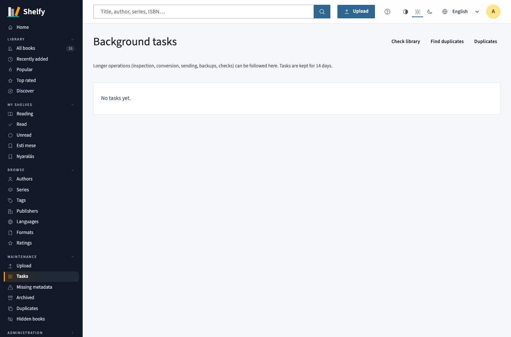

*Background tasks*

Longer operations – inspecting uploads, conversion, sending to Kindle, backups, restores – can be followed on the **Tasks** page: who started them, their status, how long they ran and the result. The sidebar shows how many are running. Administrators can start a library check (missing files) and a duplicate search from there. Tasks stay in the list for 14 days.

<a id="faq"></a>

## Frequently asked questions

**The book does not arrive on my Kindle.**  
Check the *Activity log* (as an administrator) or *My activity*: if sending failed, the reason is shown there. If it succeeded, the sender address is probably not approved at Amazon.

**Wrong metadata was taken over during upload.**  
Use *Online metadata* on the book page to search again, or fix it by hand with *Edit*.

**The cover is missing.**  
The *Missing metadata* view lists books without cover or description; Online metadata or Edit (upload a cover) helps.

**The book does not open in the reader.**  
Formats other than EPUB and PDF are converted first – if that fails, the reader says so, but you can still download the book. The Tasks page shows the reason.

**Tapping the page on the tablet does not turn it.**  
In scrolling mode a tap only shows/hides the bars – switch to *Pages* under Aa. A tap on a link or while text is selected does not turn the page either.
