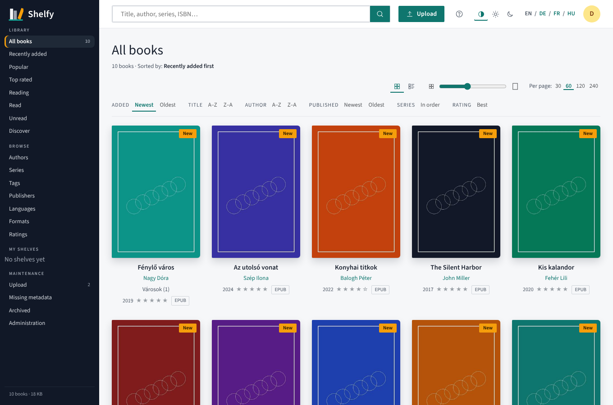
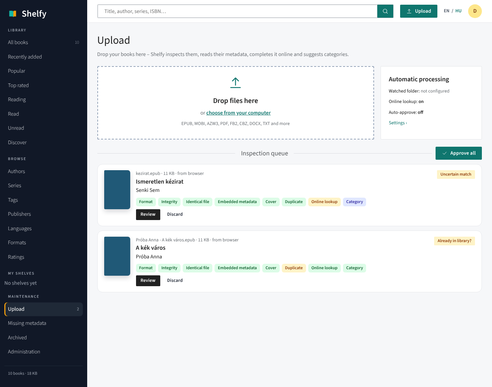
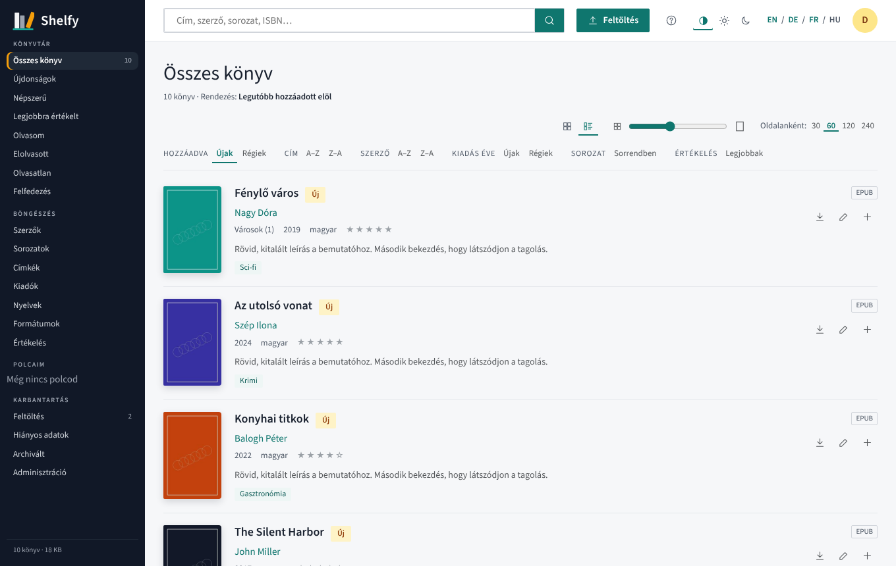
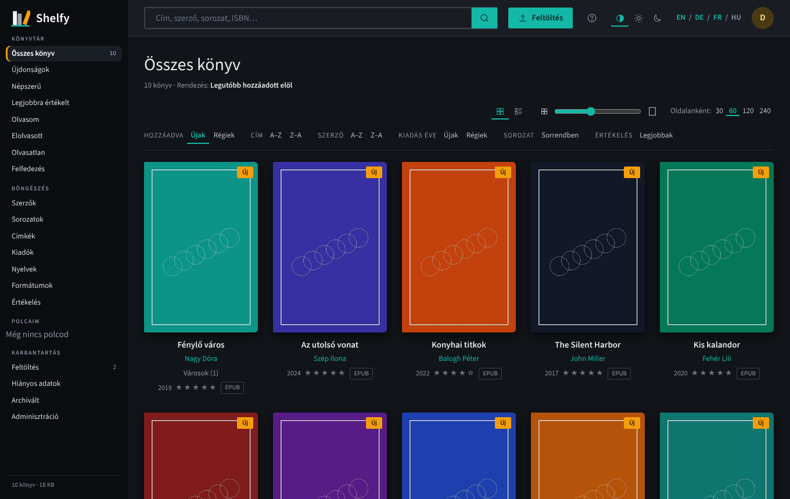
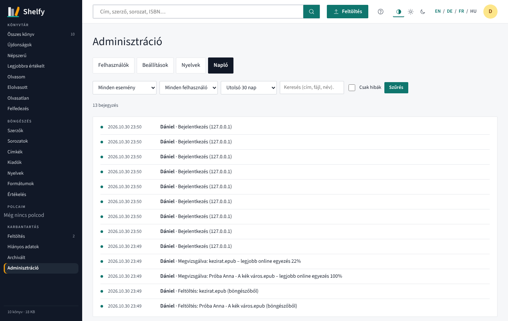
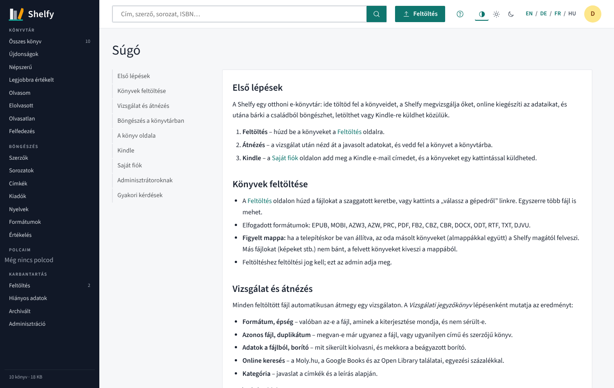
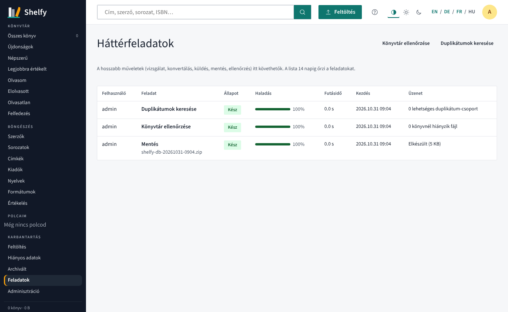
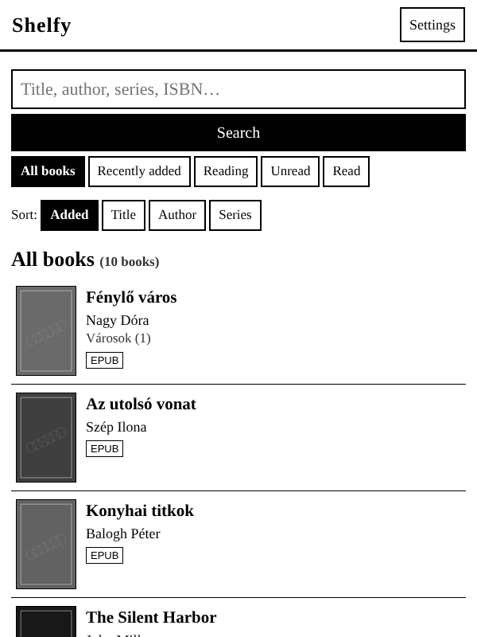
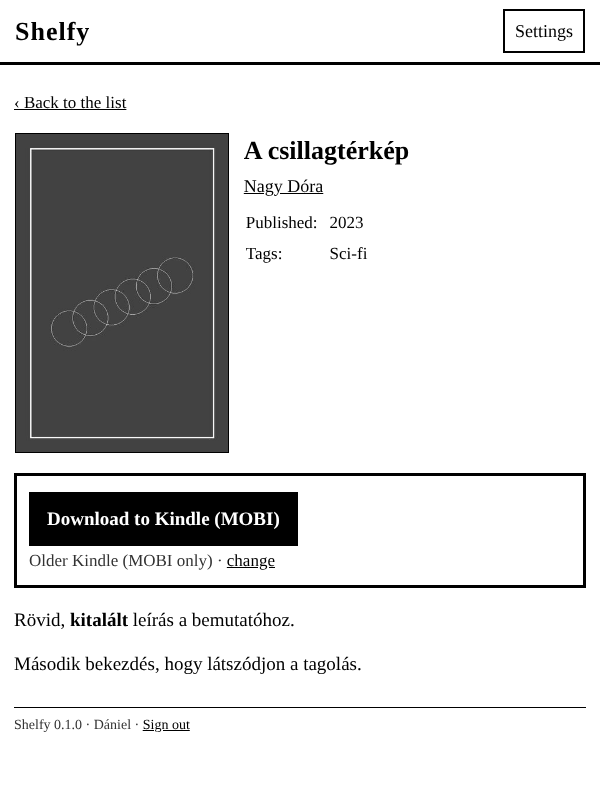

<p align="center">
  <picture>
    <source media="(prefers-color-scheme: dark)" srcset="branding/png/shelfy-logo-dark-1600.png">
    
  </picture>
</p>


*[English](README.md) · Magyar*

Saját, otthoni e-könyvtár: feltöltés, automatikus vizsgálat és adatgyűjtés, kereshető és szerkeszthető katalógus, konvertálás, küldés Kindle-re és egy egyszerű Kindle-nézet a régi Kindle-ökhöz is. Több felhasználóval, a családnak.

A felület **14 nyelven** érhető el – angol, magyar, német, francia, olasz, spanyol, portugál, lengyel, orosz, török, japán, koreai, egyszerűsített és hagyományos kínai –, mindegyikhez beépített használati útmutatóval; a nyelv a felső sávban egy legördülő listából választható. Minden felirat a `locales/*.json` fájlokban van, és a felületről is fordítható. Világos és sötét téma is van.



## Mit tud

- **Feltöltés bármilyen formátumban** (EPUB, MOBI, AZW3, PDF, FB2, CBZ, DOCX, TXT…): böngészőből behúzva, vagy egy figyelt mappába téve.
- **Vizsgálat feltöltés után**, jegyzőkönyvvel:
  - a fájl valóban az-e, aminek a kiterjesztése mondja
  - ép-e
  - megvan-e már ugyanez a fájl vagy ugyanez a könyv
  - milyen adatok vannak a fájlban
  - milyen a borító
- **Információk letöltése**: Moly.hu, Google Books, Open Library és nemzeti könyvtárak (német DNB, francia BnF, lengyel BN, japán NDL); a forrásokat és a sorrendjüket a Beállításokban választod ki. A leírás, a sorozat, a kiadás éve, a címkék és a borító egyetlen kattintással átvehető. A találatok közül te választasz, és az adatok jóváhagyás előtt szerkeszthetők.
- **Automatikus kategorizálás** a címkékből és a leírásból (krimi, fantasy, sci-fi, történelmi regény…).
- **Böngészés és rendezés**: szerzők, sorozatok, címkék, kiadók, nyelvek, formátumok és értékelés szerint, valamint a saját polcaid és olvasási állapot.
- **Rács és lista nézet**: csúszkával állítható, hány borító férjen egy sorba, és választható, hány könyv legyen egy oldalon. Listában a borító mellett az adatok és a leírás eleje is látszik.
- **Online adatfrissítés** a már felvett könyveknél: adatonként összeveti a jelenlegit és az online értéket, és csak azt veszi át, amit kijelölsz.
- **Konvertálás** az e-könyv formátumok között. Letöltéskor a hiányzó Kindle-formátumot (MOBI/AZW3/EPUB) magától elkészíti.
- **Küldés Kindle-re e-mailben**, minden felhasználónak a saját Kindle-címére.
- **Kindle-nézet** (`/kindle`): JavaScript nélküli, e-ink-barát felület. Kindle böngészőből magától ez nyílik meg, a régi Kindle MOBI-t kap.
- **Felhasználók és szerepkörök**: adminisztrátor, szerkesztő, olvasó, egyenként állítható jogokkal (feltöltés, szerkesztés, letöltés, törlés).
- **Vendég-böngészés** (kapcsoló a Beállításokban): bejelentkezés nélkül is végig lehet nézni és keresni a könyvtárban, de letölteni, küldeni vagy módosítani nem lehet.
- **E-mail felhasználónként**: közös SMTP-fiók, és ha kell, mindenkinek saját (beépített Gmail-útmutatóval). Az SMTP-jelszavak titkosítva tárolódnak.
- **Napló**: feltöltés, felvétel, küldés (a sikertelen is, okkal), letöltés, belépés és beállításváltozás időbélyeggel, szűrhetően. Minden könyvnek saját előzményei vannak, mindenki látja a saját tevékenységét.
- **Mentés és visszaállítás**: adatbázis-mentés (kicsi, másodpercek alatt) vagy teljes mentés az összes könyvfájllal, napi automatikus mentés a szerveren, visszaállítás az admin felületről vagy parancssorból. Minden visszaállítás előtt biztonsági mentés készül, a könyvtár-ellenőrzés pedig kilistázza, mely könyveknél hiányzik fájl.
- **Háttérfeladatok**: a vizsgálatok, konvertálások, küldések, mentések és visszaállítások a *Feladatok* oldalon követhetők állapottal, haladással, futásidővel és eredménnyel. Az adminisztrátor innen indíthat könyvtár-ellenőrzést és duplikátumkeresést.
- **Névjegy oldal** verziószámmal, készítővel, forráskód-linkkel és rendszerinformációval.
- **Világos és sötét téma** (automatikus, a rendszert követi, vagy kézzel választható).
- **Beépített súgó** minden nyelven, a megfelelő oldalakról linkelve.
- **Telefonra telepíthető** (webalkalmazás-leíró és ikonok).

| Feltöltés | Vizsgálat eredménye |
|---|---|
|  |  |

| Lista nézet | Sötét téma |
|---|---|
|  |  |

| Napló | Súgó |
|---|---|
|  |  |

| Háttérfeladatok | |
|---|---|
|  | |

| Kindle lista | Kindle adatlap |
|---|---|
|  |  |

## Telepítés

A Shelfy egyetlen Docker-konténerként fut. A példák Docker Compose formátumúak: bemásolhatók a **Portainer → Stacks → Add stack** szerkesztőbe vagy a NAS Docker / Container Manager alkalmazásába.

### Gyors indulás NAS-on

**1. Hozz létre két mappát** a NAS-on, például a `docker` megosztásban:

| Mappa | Mi kerül bele |
|---|---|
| `/Volume1/docker/shelfy` | minden, amit a Shelfy tárol: adatbázis, beállítások, mentések, borító-gyorsítótár, és a `library` almappában a könyvfájlok |
| `/Volume1/docker/shelfy-ingest` | a *figyelt mappa*: az ide másolt e-könyveket magától felveszi (nem kötelező) |

**2. Hozd létre a stacket** ezzel a compose fájllal. A `volumes` soroknál csak a kettőspont előtti részt írd át a saját mappáidra:

```yaml
services:
  shelfy:
    image: ghcr.io/czdanika/shelfy:latest
    container_name: shelfy
    restart: unless-stopped
    ports:
      - "18200:8080"                                  # a NAS 18200-as portján lesz elérhető
    volumes:
      - /Volume1/docker/shelfy:/data                  # adatbázis, beállítások, mentések, könyvfájlok
      - /Volume1/docker/shelfy-ingest:/ingest         # figyelt mappa (nem kötelező)
    environment:
      - TZ=Europe/Budapest                            # időzóna a napló időbélyegeihez
      - DEFAULT_LANGUAGE=hu                           # en hu de fr it es pt pl ru tr ja ko zh-Hans zh-Hant
      - INGEST_DIR=/ingest                            # bekapcsolja a figyelt mappát (a fenti kötet konténer felőli oldala)
      # - PUID=1026                                   # nem kötelező: a mappák tulajdonosa a NAS-on (lásd lent)
      # - PGID=100
```

**3. Nyisd meg** a `http://<nas-ip>:18200` címet, és hozd létre az adminisztrátori fiókot.

**4. A Shelfyben:**

1. **Beállítások** (bal oldali menü): alapnyelv, online források és sorrendjük, valamint az e-mail (SMTP) fiók a Kindle-re küldéshez. Az oldalon lépésről lépésre Gmail-útmutató is van. A feladó címét az Amazon-fiókban fel kell venni a jóváhagyott feladók közé.
2. **Adminisztráció → Felhasználók**: vedd fel a családtagokat.
3. Tölts fel néhány könyvet, vagy másold be őket a figyelt mappába.

> A régi Kindle-böngészők sok modern HTTPS-oldalt nem tudnak megnyitni (pl. Cloudflare mögött). Otthon a helyi címet használd: `http://<nas-ip>:18200`.

### Mit jelentenek a sorok

| Sor | Jelentés |
|---|---|
| `image` | a hivatalos image, `linux/amd64` és `linux/arm64` (Raspberry Pi, ARM-os NAS) változatban, a konvertáló eszközökkel együtt |
| `ports: "18200:8080"` | a bal oldali szám a NAS portja – írd át, ha a 18200 foglalt. A jobb oldali 8080 marad. |
| `/…/shelfy:/data` | **az egyetlen mappa, amit meg kell őrizni.** Ha ezt mented, a Shelfy bárhol visszaállítható. |
| `/…/shelfy-ingest:/ingest` + `INGEST_DIR=/ingest` | a figyelt mappa. Az ide másolt e-könyveket (almappákból is) felveszi, majd kiveszi a mappából; más fájlokhoz nem nyúl. Ha nem kell, mindkét sort hagyd ki. |
| `TZ` | időzóna, pl. `Europe/Budapest` |
| `DEFAULT_LANGUAGE` | a kezdő nyelv; később a Beállításokban átállítható, és mindenki választhat sajátot |
| `PUID` / `PGID` | melyik felhasználó nevében írja a fájlokat. Alapból `1000`/`1000`. Ha *permission denied* hibát látsz, vagy azt szeretnéd, hogy a fájlok a NAS-felhasználódé legyenek, add meg az ő azonosítóit (SSH-n: `id <felhasználónév>`). Indításkor a Shelfy rendbe teszi a mappák tulajdonosát. |

### Mappaútvonalak népszerű rendszereken

| Rendszer | Példa adatmappa |
|---|---|
| TerraMaster TOS | `/Volume1/docker/shelfy` |
| Synology DSM | `/volume1/docker/shelfy` |
| QNAP QTS | `/share/Container/shelfy` |
| Unraid | `/mnt/user/appdata/shelfy` |
| OpenMediaVault | `/srv/dev-disk-by-uuid-…/docker/shelfy` |
| Raspberry Pi / Linux | `/home/<felhasználó>/shelfy` vagy `./data` a compose fájl mellett |

### Változatok

**A könyvfájlok külön megosztásban** – például ha a könyvek a `Konyvek` megosztásba kerüljenek, amit amúgy is mentesz:

```yaml
    volumes:
      - /Volume1/docker/shelfy:/data
      - /Volume1/Konyvek/Shelfy:/data/library          # könyvfájlok és borítók (Szerző/Cím (id)/…)
```

**Figyelt mappa nélkül** – hagyd ki az `/ingest` kötetet és az `INGEST_DIR` sort.

**A legegyszerűbb változat** – Docker által kezelt kötet NAS-mappa helyett (ezt a NAS fájlkezelőjéből nehezebb elérni):

```yaml
services:
  shelfy:
    image: ghcr.io/czdanika/shelfy:latest
    restart: unless-stopped
    ports: ["18200:8080"]
    volumes:
      - shelfy-data:/data
volumes:
  shelfy-data:
```

**Első adminisztrátor a stackből** – add meg az `ADMIN_USER` és `ADMIN_PASSWORD` változót (legalább 8 karakter). Csak addig számít, amíg nincs felhasználó.

### Mi van az adatmappában

```text
shelfy/
├── shelfy.db         adatbázis: könyvadatok, felhasználók, polcok, olvasási állapot, napló, beállítások
├── secret.key        titkosító kulcs (munkamenetek, tárolt jelszavak) – az adatbázissal együtt őrizd
├── library/          könyvfájlok és borítók: Szerző/Cím (id)/…
├── backups/          napi automatikus adatbázis-mentések
├── cache/            borító-bélyegképek és konvertált fájlok (törölhető)
├── uploads/          átnézésre váró feltöltések
└── locales/          a felületen szerkesztett fordítások
```

### Frissítés

- **Portainer:** nyisd meg a stacket, és válaszd az *Update the stack* gombot *Re-pull image* opcióval (vagy *Pull and redeploy*).
- **Parancssor:** `docker compose pull && docker compose up -d`

Az adataid az adatmappában maradnak; az adatbázist indításkor magától frissíti.

### Hibaelhárítás

| Probléma | Megoldás |
|---|---|
| *Permission denied* a konténer naplójában, vagy nem megy a feltöltés | állítsd a `PUID`/`PGID` értékét a mappák tulajdonosára, vagy adj annak a felhasználónak írási jogot |
| Nem jön be az oldal | szabad a port? Fut a konténer (`docker ps`)? Nézd meg a naplót: `docker logs shelfy` |
| A figyelt mappa nem csinál semmit | az `INGEST_DIR` a kötet konténer felőli oldala legyen (`/ingest`), és a Beállításokban legyen bekapcsolva a *Figyelt mappa figyelése* |
| A Google Books soha nem talál semmit | a Google közös ingyenes kvótája gyakran elfogy – adj meg egy ingyenes API-kulcsot a *Beállítások → Online források* résznél, vagy hagyatkozz a többi forrásra |
| Nem megy a küldés Kindle-re | az okot a *Feladatok* oldal és a tevékenységnapló mutatja; többnyire a feladó nincs jóváhagyva az Amazonnál, vagy rossz az SMTP-jelszó (Gmailnél alkalmazásjelszó kell) |

### Környezeti változók

| Változó | Alapérték | Leírás |
|---|---|---|
| `TZ` | – | időzóna, pl. `Europe/Budapest` |
| `PUID`, `PGID` | `1000` | a felhasználó és csoport, amelynek nevében a fájlokat írja (a mappák NAS-os tulajdonosa) |
| `DATA_DIR` | `/data` | adatbázis, gyorsítótár, titkosító kulcs |
| `LIBRARY_DIR` | `/data/library` | a könyvek fájljai (Szerző/Cím (id)/…) |
| `INGEST_DIR` | – | figyelt mappa almappákkal együtt: az ide másolt e-könyveket magától felveszi (és kiveszi innen) |
| `DEFAULT_LANGUAGE` | `en` | a felület alapnyelve: `en`, `hu`, `de`, `fr`, `it`, `es`, `pt`, `pl`, `ru`, `tr`, `ja`, `ko`, `zh-Hans`, `zh-Hant` (régiós kód is jó, pl. `hu-hu`, `zh-cn`, `zh-hk`); a kategória-címkék is ezen a nyelven kerülnek a könyvekhez. Bejelentkezés előtt a böngésző nyelvét használja, ha elérhető. |
| `ONLINE_LOOKUP` | `true` | az online adatkeresés kezdőértéke (a Beállításokban átkapcsolható) |
| `METADATA_PROVIDERS` | nyelv szerint | az adatforrások kezdő listája fontossági sorrendben: `moly`, `google`, `openlibrary`, `dnb`, `bnf`, `bn_pl`, `ndl`. Ha nincs megadva, az alapnyelv dönt (pl. `hu` → a Moly.hu az első). A forrásokat, a sorrendjüket és egy opcionális Google Books API-kulcsot a Beállításokban lehet kezelni. |
| `ADMIN_USER`, `ADMIN_PASSWORD` | – | első admin fiók (ha nincs még felhasználó) |
| `SECRET_KEY` | automatikus | a munkamenet-sütik titkosító kulcsa |
| `CONVERT_TIMEOUT` | `300` | konvertálás időkorlátja másodpercben |

### Elfelejtett jelszó

Egy felhasználó jelszavát az admin az *Adminisztráció → Felhasználók* oldalon állíthatja vissza. Ha az admin a sajátját felejtette el, a szerveren futtasd ezt (a webes felületről nem érhető el):

```bash
docker exec -it shelfy python -m app.reset_password            # felhasználók listája
docker exec -it shelfy python -m app.reset_password daniel     # új jelszó beállítása
docker exec -it shelfy python -m app.reset_password daniel --admin   # …és adminná tétel
```

Utána a felhasználó minden eszközről kijelentkezik.

### Mentés, visszaállítás, költözés

Az adatbázis kicsi, a könyvfájlok a `LIBRARY_DIR` mappában vannak. Az *Adminisztráció → Mentés* oldalon:

- letölthetsz **adatbázis-mentést** (adatok, felhasználók, polcok, beállítások) vagy **teljes mentést**, ami a könyvfájlokat is tartalmazza;
- bekapcsolhatod a **napi automatikus adatbázis-mentést** a `DATA_DIR/backups` mappába (megadod, hányat őrizzen meg);
- **visszaállíthatsz** feltöltött vagy a szerveren tárolt mentésből. Előtte a jelenlegi állapotról biztonsági mentés készül.

Nagy könyvtárnál a könyvmappát a NAS saját mentőeszközeivel érdemes menteni, Shelfyvel csak az adatbázist. Költözéskor: másold át a könyvmappát, indítsd el az új Shelfyt, állítsd vissza az adatbázis-mentést, majd futtasd a *Könyvtár ellenőrzése* feladatot. Parancssorból:

```bash
docker exec shelfy python -m app.backup create                          # csak adatbázis, a DATA_DIR/backups mappába
docker exec shelfy python -m app.backup create --full -o /data/full.zip # könyvfájlokkal együtt
docker exec shelfy python -m app.backup check                           # hiányzó fájlú könyvek

# parancssori visszaállítás: előbb állítsd le a Shelfyt, aztán egy egyszeri konténerrel
docker compose stop shelfy
docker compose run --rm shelfy python -m app.backup restore /data/backups/<fájl>.zip
docker compose start shelfy
```

## Fordítás

A szövegek a `locales/<kód>.json` fájlokban vannak: angol (`en.json`, ez a referencia – a hiányzó fordítások helyén angol jelenik meg), valamint magyar, német, francia, olasz, spanyol, portugál, lengyel, orosz, török, japán, koreai, egyszerűsített és hagyományos kínai (`hu.json`, `de.json`, … `zh-Hans.json`, `zh-Hant.json`). A használati útmutató nyelvenként a `locales/help/<kód>.html` fájlban van; saját változat a `DATA_DIR/locales/help/` mappába tehető. Új nyelvet az **Adminisztráció → Nyelvek** oldalon lehet felvenni és fordítani. A felületen végzett módosítások a `DATA_DIR/locales` mappába kerülnek, így frissítéskor sem vesznek el.

Ellenőrzés, hogy minden használt kulcs le van-e fordítva:

```bash
python scripts/check_locales.py
```

## Fejlesztés

```bash
pip install -r requirements.txt pytest
pytest -q                       # a konvertálási tesztek ebook-convert nélkül kimaradnak
DATA_DIR=./data uvicorn --factory app.main:create_app --reload
```

A Moly.hu adatait az oldal nyilvános HTML-jéből olvassa, azonosítható User-Agenttel és visszafogott tempóban.
