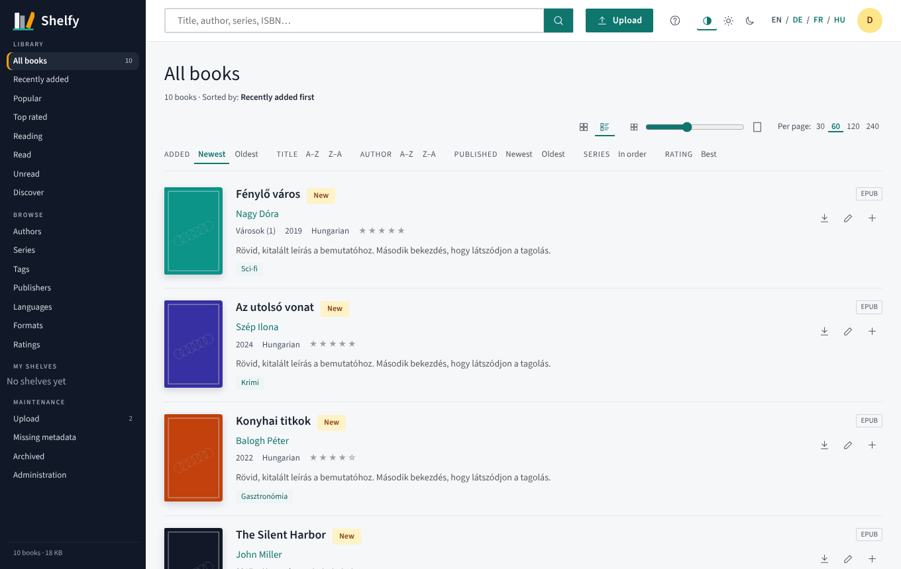
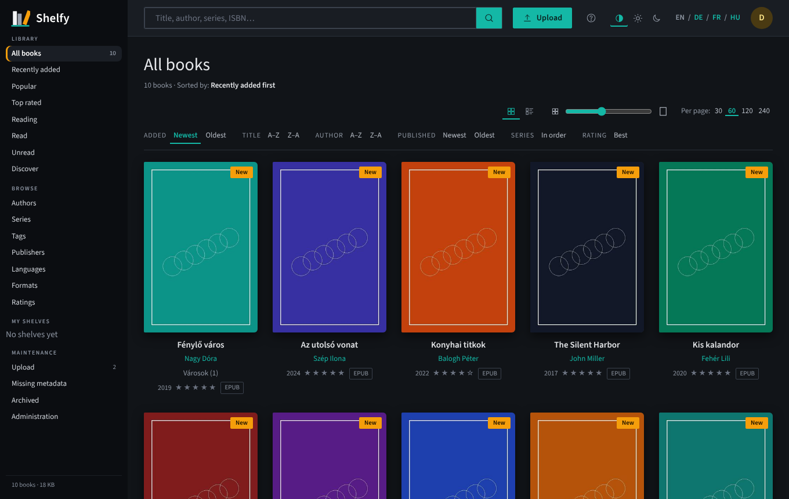
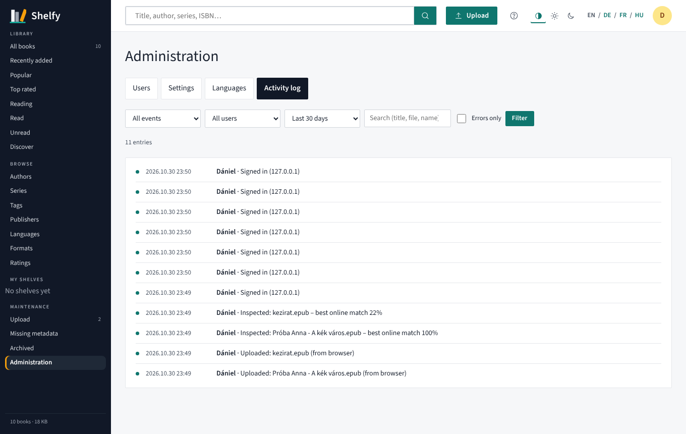
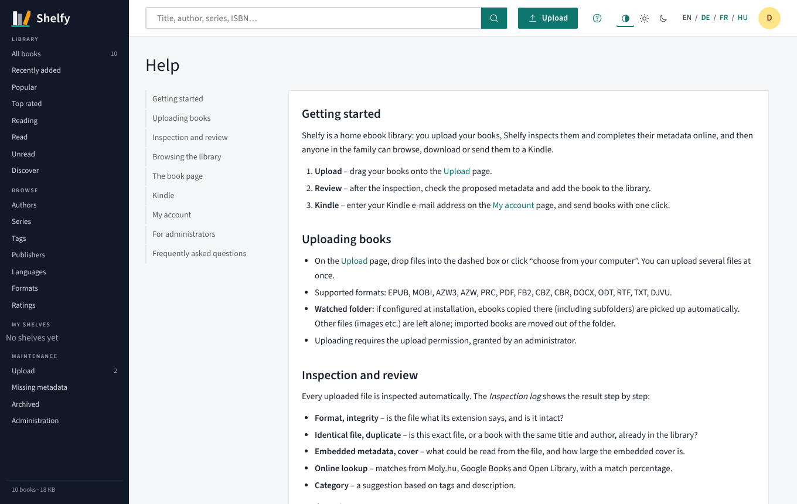

<p align="center">
  <picture>
    <source media="(prefers-color-scheme: dark)" srcset="branding/png/shelfy-logo-dark-1600.png">
    
  </picture>
</p>

*English · [Magyar](README.hu.md)*

A self-hosted ebook library for your home and family. You upload books, Shelfy inspects them and completes their metadata online, and you get a searchable, editable catalogue. It also converts formats, sends books to Kindle by e-mail, and has a simple Kindle view that works on old Kindles too.

The interface ships in **14 languages** – English, Hungarian, German, French, Italian, Spanish, Portuguese, Polish, Russian, Turkish, Japanese, Korean, Simplified and Traditional Chinese – with a built-in user guide in each, and a language picker in the top bar. Every label lives in a translation file, and you can add or edit languages from the admin interface. Light and dark themes are included.


## Features

- **Upload in any format** (EPUB, MOBI, AZW3, PDF, FB2, CBZ, DOCX, TXT…). Drag and drop in the browser, or drop files into a watched folder.
- **Inspection after upload**, with a readable log:
  - does the content match the file extension?
  - is the file intact?
  - is this exact file, or this book, already in the library?
  - what metadata is embedded?
  - how good is the cover?
- **Metadata lookup** from Moly.hu, Google Books, Open Library and national libraries (German DNB, French BnF, Polish BN, Japanese NDL). You choose the sources and their priority in Settings. You pick the right match, and description, series, year, tags and cover come over in one click. Everything stays editable before you approve.
- **Automatic categorisation** from tags and description (crime, fantasy, science fiction, historical fiction…). Category names are translated, too.
- **Browsing and sorting** by author, series, tag, publisher, language, format and rating, plus personal shelves and reading status.
- **Grid and list views**: a size slider sets how many covers fit in a row, and you choose how many books appear per page. The list view shows the cover with details and the start of the description.
- **Refresh metadata online** for books already in the library: compare current and online values field by field and take over only what you want.
- **Conversion** between ebook formats. A missing Kindle format (MOBI/AZW3/EPUB) is created automatically on download and cached.
- **Send to Kindle** by e-mail. Each user sends to their own Kindle address. If a book only exists as MOBI/AZW3, an EPUB is made first, because Amazon only accepts EPUB.
- **Kindle view** (`/kindle`): an e-ink friendly page with no JavaScript. It opens automatically in the Kindle browser, and old Kindles get MOBI.
- **Users and roles**: administrator, editor and reader, with per-user permissions for upload, edit, download and delete.
- **Guest browsing** (optional switch in Settings): visitors can look through and search the library without signing in, but cannot download, send or change anything.
- **E-mail per user**: a shared SMTP account, and optionally each user's own (with a built-in Gmail guide). SMTP passwords are stored encrypted.
- **Activity log**: uploads, additions, sends (including failures and the reason), downloads, sign-ins and settings changes, with timestamps and filters. Every book has its own history, and every user sees their own activity.
- **Backup and restore**: download a database backup (small, seconds) or a full backup with every book file, keep daily automatic backups on the server, and restore from the admin area or the command line. A safety backup is taken before every restore, and a library check lists books whose files are missing.
- **Background tasks**: inspections, conversions, sends, backups and restores show up on the *Tasks* page with status, progress, run time and result. Administrators can start a library check or a duplicate search from there.
- **About page** with version, author, source link and system information.
- **Light and dark theme** (automatic, following the system, or chosen by hand).
- **Built-in help** in every language, with links from the relevant pages.
- **Installable on phones** (web app manifest and icons).

| Upload | Inspection result |
|---|---|
|  |  |

| List view | Dark theme |
|---|---|
|  |  |

| Activity log | Help |
|---|---|
|  |  |

| Background tasks | |
|---|---|
|  | |

| Kindle list | Kindle book page |
|---|---|
|  |  |

## Installation

Shelfy runs as a single Docker container. The examples use Docker Compose, which you can paste straight into **Portainer → Stacks → Add stack** or into the Docker / Container Manager app of your NAS.

### Quick start on a NAS

**1. Create two folders** on the NAS, for example in the shared Docker folder (on TerraMaster: `DockerAppsData`):

| Folder | What goes there |
|---|---|
| `/Volume1/DockerAppsData/shelfy` | everything Shelfy keeps: the database, settings, backups, cover cache and – in its `library` subfolder – the book files |
| `/Volume1/DockerAppsData/shelfy-ingest` | the *watched folder*: ebooks you copy here are imported automatically (optional) |

**2. Create the stack** with this compose file. Change only the left side of the `volumes` lines (the part before the `:`) to your own folders:

```yaml
services:
  shelfy:
    image: ghcr.io/czdanika/shelfy:latest
    container_name: shelfy
    restart: unless-stopped
    ports:
      - "18200:8080"                                  # open Shelfy on port 18200 of the NAS
    volumes:
      - /Volume1/DockerAppsData/shelfy:/data                  # database, settings, backups, book files
      - /Volume1/DockerAppsData/shelfy-ingest:/ingest         # watched folder (optional)
    environment:
      - TZ=Europe/Budapest                            # your time zone, for the timestamps in the log
      - DEFAULT_LANGUAGE=hu                           # en hu de fr it es pt pl ru tr ja ko zh-Hans zh-Hant
      - INGEST_DIR=/ingest                            # turns the watched folder on (container side of the volume above)
      # - PUID=1026                                   # optional: the NAS user that owns the folders above (see below)
      # - PGID=100
```

**3. Open** `http://<nas-ip>:18200` and create the administrator account.

**4. In Shelfy:**

1. **Settings** (left menu): default language, online sources and their order, and the e-mail (SMTP) account for Send to Kindle. There is a step-by-step Gmail guide on the page. Add the sender address to the approved senders in your Amazon account.
2. **Administration → Users**: add your family members.
3. Upload a few books, or copy them into the watched folder.

> Old Kindle browsers often cannot open modern HTTPS sites (for example behind Cloudflare). At home, use the local address: `http://<nas-ip>:18200`.

### What the lines mean

| Line | Meaning |
|---|---|
| `image` | the official image, built for `linux/amd64` and `linux/arm64` (Raspberry Pi, ARM NAS), with the conversion tools included |
| `ports: "18200:8080"` | the left number is the port on the NAS – change it if 18200 is taken. The right number stays 8080. |
| `/…/shelfy:/data` | **the only folder you must keep.** Back it up, and Shelfy can be restored anywhere. |
| `/…/shelfy-ingest:/ingest` + `INGEST_DIR=/ingest` | the watched folder. Ebooks copied here (subfolders included) are imported and then moved out; other files are left alone. Leave both lines out if you do not need it. |
| `TZ` | time zone, e.g. `Europe/London`, `Europe/Berlin`, `America/New_York` |
| `DEFAULT_LANGUAGE` | the starting language; it can be changed later in Settings, and every user can pick their own |
| `PUID` / `PGID` | which user the container writes files as. The default is `1000`/`1000`. If you see *permission denied* errors, or want the files to belong to your NAS user, set these to that user's IDs (`id <username>` over SSH). Shelfy fixes the folder ownership on start. |

### Folder paths on popular systems

| System | Example data folder |
|---|---|
| TerraMaster TOS | `/Volume1/DockerAppsData/shelfy` |
| Synology DSM | `/volume1/docker/shelfy` |
| QNAP QTS | `/share/Container/shelfy` |
| Unraid | `/mnt/user/appdata/shelfy` |
| OpenMediaVault | `/srv/dev-disk-by-uuid-…/docker/shelfy` |
| Raspberry Pi / Linux | `/home/<user>/shelfy` or `./data` next to the compose file |

### Variations

**Book files on a separate share** – for example, if the books should live in your `Books` share, which is backed up anyway:

```yaml
    volumes:
      - /Volume1/DockerAppsData/shelfy:/data
      - /Volume1/Books/Shelfy:/data/library            # book files and covers (Author/Title (id)/…)
```

**Without a watched folder** – leave out the `/ingest` volume and `INGEST_DIR`.

**Simplest possible setup** – a Docker-managed volume instead of a NAS folder (harder to reach from the NAS file manager):

```yaml
services:
  shelfy:
    image: ghcr.io/czdanika/shelfy:latest
    restart: unless-stopped
    ports: ["18200:8080"]
    volumes:
      - shelfy-data:/data
volumes:
  shelfy-data:
```

**First administrator from the stack** – add `ADMIN_USER` and `ADMIN_PASSWORD` (at least 8 characters). They are only used while there are no users yet.

### What is inside the data folder

```text
shelfy/
├── shelfy.db         database: metadata, users, shelves, reading status, log, settings
├── secret.key        encryption key (sessions, stored passwords) – keep it with the database
├── library/          book files and covers: Author/Title (id)/…
├── backups/          daily automatic database backups
├── cache/            cover thumbnails and converted files (can be deleted)
├── uploads/          files waiting for review
└── locales/          translations edited in the interface
```

### Updating

- **Portainer:** open the stack and choose *Update the stack* with *Re-pull image* (or *Pull and redeploy*).
- **Command line:** `docker compose pull && docker compose up -d`

Your data stays in the data folder; the database is upgraded automatically on start.

### Troubleshooting

| Problem | Solution |
|---|---|
| *Permission denied* in the container log, or uploads fail | set `PUID`/`PGID` to the owner of the folders, or give that user write access to them |
| The page does not open | is the port free? Is the container running (`docker ps`)? Check the log: `docker logs shelfy` |
| The watched folder does nothing | `INGEST_DIR` must be the container side of the volume (`/ingest`), and *Watch the import folder* must be on in Settings |
| Google Books never finds anything | Google's shared free quota is often used up – add a free API key under *Settings → Online sources*, or rely on the other sources |
| Sending to Kindle fails | the reason is shown in *Tasks* and in the activity log; usually the sender is not approved at Amazon, or the SMTP password is wrong (Gmail needs an app password) |

### Environment variables

| Variable | Default | Description |
|---|---|---|
| `TZ` | – | time zone, e.g. `Europe/Budapest` |
| `PUID`, `PGID` | `1000` | user and group the container writes files as (set them to the NAS user that owns the folders) |
| `DATA_DIR` | `/data` | database, caches, secret key |
| `LIBRARY_DIR` | `/data/library` | book files (`Author/Title (id)/…`) |
| `INGEST_DIR` | – | watched folder, including subfolders: ebook files copied here are imported automatically (and moved out of it) |
| `DEFAULT_LANGUAGE` | `en` | starting default interface language (can be changed in Settings); also the language of category tags. One of `en`, `hu`, `de`, `fr`, `it`, `es`, `pt`, `pl`, `ru`, `tr`, `ja`, `ko`, `zh-Hans`, `zh-Hant` (region codes such as `en-us`, `zh-cn`, `zh-hk` also work). Before signing in, the browser's language is used if it is available. |
| `ONLINE_LOOKUP` | `true` | starting value for online metadata lookup (can be switched in Settings) |
| `METADATA_PROVIDERS` | by language | starting list of metadata sources, in order of priority: `moly`, `google`, `openlibrary`, `dnb`, `bnf`, `bn_pl`, `ndl`. If unset, the default language decides (e.g. `hu` → Moly.hu first, `de` → DNB first). Sources, their order and an optional Google Books API key are managed in Settings. |
| `ADMIN_USER`, `ADMIN_PASSWORD` | – | first admin account (only if there are no users yet) |
| `SECRET_KEY` | generated | key for the encrypted session cookie |
| `CONVERT_TIMEOUT` | `300` | conversion timeout in seconds |

### Forgotten password

A user's password can be reset by an administrator under *Administration → Users*. If the administrator has forgotten their own password, run this on the server (it is not available from the web):

```bash
docker exec -it shelfy python -m app.reset_password            # list users
docker exec -it shelfy python -m app.reset_password daniel     # set a new password
docker exec -it shelfy python -m app.reset_password daniel --admin   # …and make the user an administrator
```

The user is signed out on every device afterwards.

### Backup, restore and moving to another server

The database is small; the book files live in `LIBRARY_DIR`. Under *Administration → Backup* you can:

- download a **database backup** (metadata, users, shelves, settings, cover references) or a **full backup** that also contains every book file;
- keep **automatic daily database backups** in `DATA_DIR/backups` (you choose how many are kept);
- **restore** an uploaded or stored backup. A safety backup of the current state is written first.

For a large library, back up the book folder with your usual NAS tools and only the database through Shelfy. To move to a new server: copy the library folder over, start Shelfy there, restore the database backup, then run *Check library*. From the command line:

```bash
docker exec shelfy python -m app.backup create                          # database only, into DATA_DIR/backups
docker exec shelfy python -m app.backup create --full -o /data/full.zip # with book files
docker exec shelfy python -m app.backup check                           # books with missing files

# restoring from the command line: stop Shelfy first, then run a one-off container
docker compose stop shelfy
docker compose run --rm shelfy python -m app.backup restore /data/backups/<file>.zip
docker compose start shelfy
```

## Translations

Translations live in `locales/<code>.json`. English (`en.json`) is the reference: new languages are translated from it, and any missing text falls back to English. Thirteen more are shipped: `hu`, `de`, `fr`, `it`, `es`, `pt`, `pl`, `ru`, `tr`, `ja`, `ko`, `zh-Hans` (Simplified Chinese) and `zh-Hant` (Traditional Chinese).

The user guide is in `locales/help/<code>.html`, one file per language with the same sections (a missing language falls back to English). A customised guide can be placed in `DATA_DIR/locales/help/`.

- Keys are grouped by area: `nav.*`, `book.*`, `upload.*`, `insp.*` (inspection steps), `cat.*` (categories), `admin.*`, `msg.*`… Placeholders look like `{n}`.
- **From the interface**: *Administration → Languages* shows how complete each language is. There you can edit any text or add a new language. Edits are saved to `DATA_DIR/locales`, so they survive image updates.
- **In the repository**: copy `locales/en.json` to `locales/<code>.json`, set `_meta.name`, translate the values and open a pull request.

To check that every key used in the code and templates exists in every language:

```bash
python scripts/check_locales.py
```

## Development

```bash
pip install -r requirements.txt pytest
pytest -q                      # conversion tests are skipped if ebook-convert is not installed
DATA_DIR=./data uvicorn --factory app.main:create_app --reload
```

Stack: FastAPI, Jinja2, SQLite, and the `ebook-meta` / `ebook-convert` command-line tools. Moly.hu metadata is read from its public HTML pages, with an identifiable User-Agent and at a modest rate.
