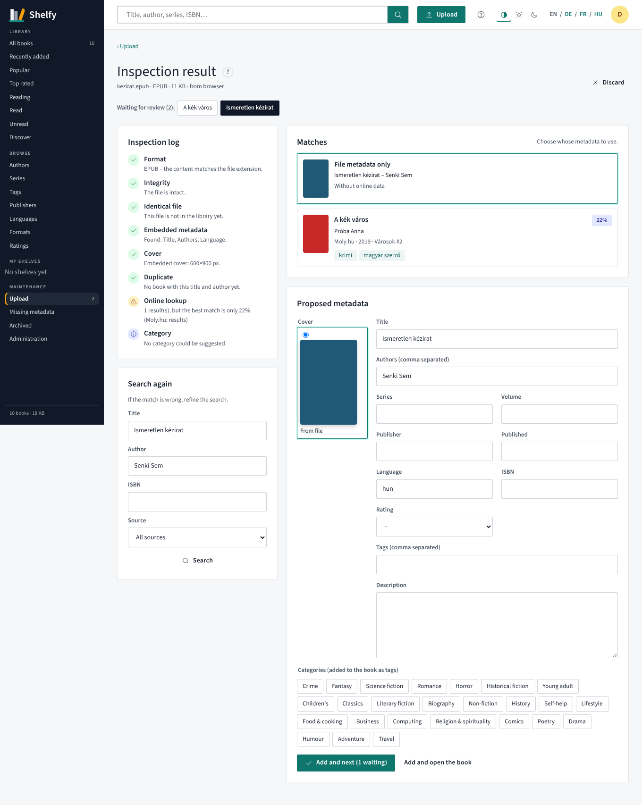

# Shelfy

*English · [Magyar](README.hu.md)*

A self-hosted ebook library for your home and family. You upload books, Shelfy inspects them and completes their metadata online, and you get a searchable, editable catalogue. It also converts formats, sends books to Kindle by e-mail, and has a simple Kindle view that works on old Kindles too.

The interface ships in **English** and **Hungarian**. Every label lives in a translation file, and you can add or edit languages from the admin interface.


## Features

- **Upload in any format** (EPUB, MOBI, AZW3, PDF, FB2, CBZ, DOCX, TXT…). Drag and drop in the browser, or drop files into a watched folder.
- **Inspection after upload**, with a readable log:
  - does the content match the file extension?
  - is the file intact?
  - is this exact file, or this book, already in the library?
  - what metadata is embedded?
  - how good is the cover?
- **Metadata lookup** from Moly.hu, Google Books and Open Library. You pick the right match, and description, series, year, tags and cover come over in one click. Everything stays editable before you approve.
- **Automatic categorisation** from tags and description (crime, fantasy, science fiction, historical fiction…). Category names are translated, too.
- **Browsing and sorting** by author, series, tag, publisher, language, format and rating, plus personal shelves and reading status.
- **Conversion** between ebook formats. A missing Kindle format (MOBI/AZW3/EPUB) is created automatically on download and cached.
- **Send to Kindle** by e-mail. Each user sends to their own Kindle address. If a book only exists as MOBI/AZW3, an EPUB is made first, because Amazon only accepts EPUB.
- **Kindle view** (`/kindle`): an e-ink friendly page with no JavaScript. It opens automatically in the Kindle browser, and old Kindles get MOBI.
- **Users and roles**: administrator, editor and reader, with per-user permissions for upload, edit, download and delete.

| Upload | Inspection result |
|---|---|
|  |  |

| Kindle list | Kindle book page |
|---|---|
|  |  |

## Installation (Docker Compose / Portainer)

See [`docker-compose.example.yml`](docker-compose.example.yml).

```yaml
services:
  shelfy:
    image: ghcr.io/czdanika/shelfy:latest
    restart: unless-stopped
    ports: ["18200:8080"]
    volumes:
      - shelfy-data:/data
    environment:
      - DEFAULT_LANGUAGE=en                     # en | hu
volumes:
  shelfy-data:
```

Open `http://<server>:18200` and create the administrator account. Then:

1. **Administration → Settings** is where you set up SMTP for Send to Kindle. Add the sender address to the approved senders in your Amazon account.
2. **Administration → Users** is where you add your family members.

> Old Kindle browsers often cannot open modern TLS sites (for example behind Cloudflare). At home, use the local address: `http://<server-ip>:18200`.

The image is built for `linux/amd64` and `linux/arm64`, with the conversion tools included.

### Environment variables

| Variable | Default | Description |
|---|---|---|
| `DATA_DIR` | `/data` | database, caches, secret key |
| `LIBRARY_DIR` | `/data/library` | book files (`Author/Title (id)/…`) |
| `INGEST_DIR` | – | watched folder; files put here are processed automatically |
| `DEFAULT_LANGUAGE` | `en` | default interface language; also the language of category tags |
| `ONLINE_LOOKUP` | `true` | enable or disable online metadata lookup |
| `METADATA_PROVIDERS` | `moly,google,openlibrary` | metadata sources, in order |
| `ADMIN_USER`, `ADMIN_PASSWORD` | – | first admin account (only if there are no users yet) |
| `SECRET_KEY` | generated | key for the encrypted session cookie |
| `CONVERT_TIMEOUT` | `300` | conversion timeout in seconds |

### Forgotten password

A user's password can be reset by an administrator under *Administration → Users*. If the administrator has forgotten their own password, run this on the server (it is not available from the web):

```bash
docker exec -it shelfy python -m app.reset_password            # list users
docker exec -it shelfy python -m app.reset_password daniel     # set a new password
docker exec -it shelfy python -m app.reset_password daniel --admin   # …and make the user an administrator
```

The user is signed out on every device afterwards.

## Translations

Translations live in `locales/<code>.json`. English (`en.json`) is the reference: new languages are translated from it, and any missing text falls back to English. Hungarian (`hu.json`) is shipped as well.

- Keys are grouped by area: `nav.*`, `book.*`, `upload.*`, `insp.*` (inspection steps), `cat.*` (categories), `admin.*`, `msg.*`… Placeholders look like `{n}`.
- **From the interface**: *Administration → Languages* shows how complete each language is. There you can edit any text or add a new language. Edits are saved to `DATA_DIR/locales`, so they survive image updates.
- **In the repository**: copy `locales/en.json` to `locales/<code>.json`, set `_meta.name`, translate the values and open a pull request.

To check that every key used in the code and templates exists in every language:

```bash
python scripts/check_locales.py
```

## Development

```bash
pip install -r requirements.txt pytest
pytest -q                      # conversion tests are skipped if ebook-convert is not installed
DATA_DIR=./data uvicorn --factory app.main:create_app --reload
```

Stack: FastAPI, Jinja2, SQLite, and the `ebook-meta` / `ebook-convert` command-line tools. Moly.hu metadata is read from its public HTML pages, with an identifiable User-Agent and at a modest rate.
